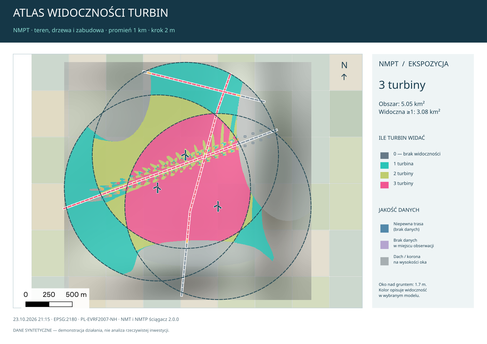
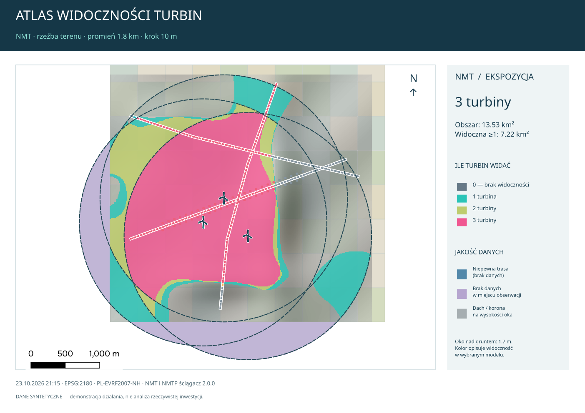

# NMT i NMTP ściągacz 2.0.0 — atlas widoczności całego otoczenia

[Pobierz ZIP instalacyjny 2.0.0](https://github.com/misinskimichal/pobieracz_danych_gugik/raw/refs/heads/codex/nmt-nmtp-sciagacz/releases/NMT%20i%20NMTP%20%C5%9Bci%C4%85gacz-2.0.0.zip).

Wydanie zastępuje dwa osobne okna jednym formularzem. Podstawowym wynikiem jest **mapa całych kół wokół turbin**, nie lista odpowiedzi dla kilku par. Obserwatorzy są opcjonalni. NMT i NMPT mają niezależne promienie oraz kroki obliczeń, a gotowy atlas można oglądać w QGIS, PDF, PNG i lokalnym HTML.

## Co było nieodpowiednie w poprzednim wyniku

Dostarczony raport 1.2.0 był spójny technicznie, ale nie odpowiadał oczekiwanemu produktowi: 50 par, 43 poza promieniem, 7 w zasięgu, w tym 3 przesłonięte i 4 widoczne. Nie zawierał rastrowej mapy otoczenia. To nie była awaria transferu — był to zbyt wąski model zadania. W 2.0.0 koło jest badane niezależnie od istnienia warstwy obserwatorów.

## Instalacja i pierwsza próba

1. Zakończ wcześniejsze zadania wtyczki. W QGIS wybierz **Wtyczki → Zarządzanie wtyczkami → Zainstaluj z ZIP** i wskaż pobrany plik bez rozpakowywania.
2. Uruchom ponownie QGIS po aktualizacji, aby wymienić wszystkie moduły Pythona. W razie potrzeby odinstaluj poprzednią wersję i zainstaluj nowy ZIP. Oddzielne foldery danych nie są usuwane.
3. Dodaj punktową warstwę turbin do projektu i otwórz wtyczkę. Jest jedna pozycja menu i jeden formularz.
4. Wybierz **Pobierz potrzebne dane i utwórz atlas widoczności**. Wskaż turbiny, opcjonalnie tylko zaznaczone.
5. Podaj wysokość piasty nad gruntem i średnicę wirnika w metrach. Możesz wybrać pola atrybutów zamiast stałych wartości. Puste pole oznacza stałą z lewej. Brak liczby w wybranym polu jest problemem obiektu, nie automatyczną zmianą wysokości.
6. Wysokość oka w otoczeniu domyślnie wynosi 1,7 m ponad gruntem NMT.
7. Ustaw osobno promień koła i krok mapy NMT oraz NMPT. Na pierwszą próbę wybierz jedną turbinę i np. NMT **1000 m / 5 m**, NMPT **650 m / 1 m**. Gdy wynik będzie sprawdzony, rozszerz zakres.
8. Wskaż foldery NMT, NMPT i atlasów. Użyj dotychczasowych folderów, aby ponownie wykorzystać zgodne kafle. Do NMPT potrzebny jest także NMT ustalający poziom gruntu; można jednak wyłączyć samą mapę NMT.
9. Drogi, zabudowę/działki i obserwatorów możesz zostawić puste. Nie blokuje to obliczeń ani map kół.
10. Kliknij **Utwórz atlas widoczności**. Pozostaw zaznaczone pokazywanie atlasu oraz eksport, jeśli chcesz od razu otrzymać prezentację.

Metadane dopuszczają QGIS 3.28–3.x i Python >=3.9. Testowano QGIS 3.40.6, Qt5, GDAL 3.10.3, Python 3.13 na Linuksie. Nie wykonano tu testów na Windows i macOS. QGIS 4 nie jest objęty wydaniem. Biblioteki pochodzą ze środowiska QGIS: GDAL/OGR, NumPy, requests, lxml i PyQGIS. Nie jest potrzebny serwer, Open3D ani GRASS.

## Koła NMT i NMPT

| Ustawienie | NMT | NMPT |
|---|---|---|
| Cel | Szeroka ocena rzeźby terenu | Szczegółowe przesłanianie przez teren, drzewa i dachy |
| Domyślny promień | 20000 m | 1000 m |
| Domyślny krok mapy | 10 m | 1 m |
| Własne wartości | Tak | Tak, np. 650 / 1000 / 1500 m i krok 0,5 / 1 / 2 m |
| Obserwatorzy wymagani | Nie | Nie |

Promień wyznacza dysk wokół każdej turbiny, nie pierścień i nie punkt pod turbiną. Mapa pokazuje miejsca w otoczeniu, z których widać turbinę na zadanej wysokości. Obliczenia mogą zaczynać się matematycznie na końcu po stronie turbiny dzięki wzajemności linii widzenia, lecz jej wysokość jest rzeczywistą wysokością piasty/łopaty nad gruntem. Nie jest to analiza z oka na ziemi pod turbiną.

NMT i NMPT pozostają oddzielnymi produktami. NMPT 1 km nie jest udawane jako model pokrycia całego NMT 20 km. Oko jest nad gruntem NMT, a nie automatycznie na dachu NMPT. Gdy punkt oka leży pod powierzchnią dachu/korony w modelu, mapa jakości to zaznacza.

Krok mapy oznacza wielkość komórki obliczeń, nie błąd pomiaru ani nową dokładność źródła. Piksel danych źródłowych wybiera się oddzielnie po rozwinięciu ustawień źródeł. Przy większym kroku przeszkody są agregowane maksimum; mały dach lub grzbiet nie znika przez uśrednienie. Taki model jest aproksymacją, zwłaszcza na stromych stokach i na granicach komórek.

## Drogi, zabudowa i obserwatorzy z projektu

Wybierz istniejące warstwy z list w sekcji **Ważne miejsca z projektu — opcjonalne**. Jeśli masz pliki na dysku, najpierw dodaj je standardowo do QGIS. Obliczenia ograniczają przeglądanie warstw do otoczenia analizowanych rastrów.

- **Drogi:** dzielone na odcinki do 50 m. Próbki określają udział miejsc z potwierdzoną widocznością i maksymalną liczbę widocznych turbin. Kolorowe linie mają białe obramowanie dla czytelności na ortofotomapie.
- **Zabudowa/działki:** oceniane są próbki obrysu odsuniętego na zewnątrz o 2 m. Nie jest wybierany automatycznie jeden punkt pod dachem. Obrys działki nie staje się bryłą zasłaniającą widok.
- **Obserwatorzy:** punkty są próbkowane w swojej lokalizacji; poligony po zewnętrznym obrysie. To dodatkowy wynik przy pełnej mapie koła.

Próbki są rozmieszczane zwykle nie gęściej niż co 10 m lub co krok mapy, jeśli ten jest większy; dla pojedynczego obrysu stosowany jest także limit próbek. To screening ekspozycji, nie dowód widoczności każdego miejsca elewacji lub działki. Na rolę/model zapisywane jest do 20000 elementów kontekstu. Gdy limit zostanie osiągnięty, raport `context_summary.truncated` to ujawnia. Podstawowa mapa koła nie jest przez ten limit skracana.

Tabele zawierają `probki`, `widoczne_pct`, `niepewne_pct`, `turbin_max`, `piast_max` i metodę próbkowania. Udział widocznych próbek jest dolnym ograniczeniem przy brakach danych; nie jest procentem powierzchni widocznego wirnika.

## Jak oglądać atlas

W projekcie powstaje jedna grupa atlasu z podgrupami NMT/NMPT. Domyślnie pokazany jest NMPT, gdy został obliczony; NMT pozostaje gotowy do przełączenia. Nie nakłada się dwóch różnych wyników w sposób sugerujący jeden wspólny model.

1. **Ile turbin widać:** turkus oznacza mniejszą liczbę widocznych turbin, jaśniejsze odcienie i róż większą. Wartość 0 oznacza brak potwierdzonej widoczności w modelu.
2. **Zakres widocznego wirnika:** alternatywna, początkowo wyłączona warstwa. Pokazuje brak, górny zasięg łopaty, piastę, dolny zasięg wirnika albo wynik nierozstrzygnięty. Liczone są trzy punkty wysokościowe; nie wyznaczono procentu widocznej powierzchni łopat ani ich animacji.
3. **Jakość:** osobna nakładka wskazuje niepewne trasy, braki w miejscu obserwacji i oko pod powierzchnią NMPT.
4. **Drogi i zabudowa:** nakładki ekspozycji pomagają szybko wskazać ważne miejsca.
5. **Granice i turbiny:** granice kół, symbole turbin i cieniowanie terenu uzupełniają mapę.

W stylach warstwy liczby turbin można przełączać **Ile turbin widać** / **Widoczność i cienie**. Style QML są zapisywane przy danych. W eksportowanym atlasie każdy model dostaje osobną stronę A4 poziomo: mapę, legendę bez technicznych nazw kanałów, skalę, północ, promień, krok, obszar i powierzchnię z widocznością co najmniej jednej turbiny. Eksport uwzględnia widoczne podkłady projektu. Bez ortofotomapy działa wygenerowane cieniowanie.

`atlas.html` otwiera lokalny przegląd z mapami, kartami podsumowania i linkami do PDF, GeoPackage, CSV i raportu. Nie potrzebuje serwera ani zewnętrznych bibliotek internetowych. Zachowaj HTML i PNG w tym samym folderze.

Przykłady poniżej pochodzą z faktycznego działania modułu, ale **wszystkie dane demonstracyjne są syntetyczne**, włącznie z terenem, budynkami, drogami i turbinami. Nie przedstawiają wyników dla inwestycji użytkownika.

## Pobieranie, wydajność i postęp

Automatyczne pobieranie pokrywa koła z niewielkim marginesem obliczeniowym, deduplikuje kafle i korzysta ze zgodnych plików. Pomocniczy NMT do NMPT jest pobierany w tym samym układzie wysokościowym; inny pion nie jest cichym zamiennikiem. Modele mogą mieć różne piony jako oddzielne produkty, lecz wewnątrz jednego obliczenia NMPT grunt i pokrycie muszą być spójne.

Przed startem widać szacowaną liczbę komórek i transfer na jedno koło. Szacunek zakłada numeryczne ASCII, nie uwzględnia dokładnie kompresji źródła, cache, pokrywania się kół ani wszystkich kafli brzegowych. Koło NMPT o promieniu 20 km i źródle 0,5 m obejmuje około 5 miliardów pikseli; sam wybór grubszego kroku wynikowego nie usuwa kosztu pozyskania drobnego źródła. Dlatego zalecany jest duży zasięg NMT i potrzebny zasięg NMPT.

Ograniczenia ochronne: do 40 mln komórek w lokalnym kwadracie koła, 400 mln w rastrze zbiorczym i 1000 turbin. Krok nie może być większy od promienia. Limity są sprawdzane przed transferem. Największe zadania nadal mogą wymagać wielu GB RAM/dysku i długiego czasu. Źródłowe rastry są czytane blokami; turbiny przetwarzane kolejno, zbiorcze rastry zapisywane oknami, a piramidy przyspieszają mapę.

Widać etap, aktualną turbinę i wysokość wirnika, czas, przybliżone ETA modelu. Przy pobieraniu także aktywne pliki, MB, prędkość i szacowane pozostałe MB/ETA zasobu oraz transfer łączny. Zamknięcie/ukrycie okna nie anuluje zadania. Anulowanie zachowuje ukończone pliki i raport; połączenie może czekać do 90 s.

## Algorytm i uzasadnienie

1. Snapshot punktów i opcjonalnych warstw jest tworzony w GUI. `AtlasTask` pracuje w tle, geometrie są przeliczane do EPSG:2180.
2. `AtlasEngine` planuje koła dla modeli. Istniejący `Engine` obsługuje WCS, warianty, cache, ponowienia, kontrolę NoData i raporty transferów.
3. `RasterStore` weryfikuje zasób, georeferencję i pion. `ModelSources` buduje wirtualne mozaiki oraz oddzielne binarne maski ważności. Nie scala całych folderów w pamięci.
4. Przeszkody są sprowadzane do kroku analizy przez maksimum. Dla NMPT poziom oka pochodzi z pomocniczego NMT. Model NMT reprezentuje grunt na swojej siatce obliczeniowej.
5. GDAL Viewshed w trybie minimalnej **bezwzględnej** wysokości celu oblicza powierzchnię widoczności z rzeczywistej wysokości turbiny. Wynik jest porównywany z okiem w otoczeniu nad NMT. Nie używa się stałego oka nad dachem DSM. Obliczane są górny zasięg łopaty, piasta i dolny zasięg wirnika.
6. Domyślna korekta krzywizny/refrakcji to `6/7`; można ją wyłączyć. Tryb `GVM_Max` jest konserwatywną aproksymacją rastrową, a nie niezależnym dokładnym ray tracingiem każdej linii 3D.
7. Braki są liczone dwukrotnie: bardzo niska oraz bardzo wysoka przeszkoda w miejscu braku. Zgodny wynik daje rozstrzygnięcie w modelu, rozbieżny niepewność. Brak danych w miejscu oka pozostaje brakiem. Techniczne wysokości skrajne wykraczają poza dopuszczany zakres fizycznych danych wejściowych, a nie udają rzeczywistych wysokości terenu.
8. Maska ważności jest agregowana minimum przy **0 jako rzeczywistej informacji o braku**, nie jako ignorowanym NoData. Osobny znacznik 255 zapobiega usunięciu małej dziury podczas zmniejszania rozdzielczości.
9. Sztuczne pionowe przesunięcie obliczeniowe Float64 zapobiega obcięciu minimalnych wysokości do zera w GDAL, np. poniżej poziomu morza; po obliczeniu jest odejmowane. Nie zmienia pionu danych ani wysokości fizycznych.
10. Mapy są sumowane do GeoTIFF UInt16/Byte i czytane blokowo przez moduł ekspozycji. QGIS dodaje warstwy i tworzy layout dopiero po zakończeniu zapisu w workerze.

## Pliki i interpretacja

W folderze `atlas_DATA_ID`:

| Plik | Zawartość |
|---|---|
| `NMT/count.tif`, `NMPT/count.tif` | Potwierdzona liczba widocznych najwyższych punktów łopaty; 65535 poza analizą |
| `hub.tif`, `bottom.tif` | Liczba widocznych piast / dolnych punktów zasięgu wirnika |
| `unknown.tif` | Liczba turbin z nierozstrzygniętą widocznością najwyższego punktu |
| `scope.tif` | Liczba turbin w zadanym promieniu piksela |
| `rotor.tif` | 0 poza analizą, 1 brak, 2 góra, 3 także piasta, 4 także dół, 5 nierozstrzygnięte |
| `quality.tif` | 0 poza, 1 komplet modelu, 2 niepewna trasa, 3 brak danych w miejscu oka, 4 oko pod powierzchnią NMPT |
| `hillshade.tif` | Cieniowanie pomocnicze, gdy dostępny jest NMT |
| `atlas.gpkg` | Turbiny, koła i opcjonalne warstwy ekspozycji |
| `ekspozycja.csv` | Tabela próbek ważnych miejsc, UTF-8 z BOM i średnikiem |
| `report.json`, `report.md`, `events.jsonl` | Konfiguracja, manifest nagłówków, postęp, problemy i interpretacja |
| `atlas.pdf`, `atlas.png`, `atlas_2.png`, `atlas.html` | Opcjonalna prezentacja |

Przy niepewności `count` jest dolnym ograniczeniem; 0 nie dowodzi braku widoczności wszystkich turbin, jeśli `unknown` lub nakładka jakości wskazuje braki. Obszar kół liczony jest jako suma komórek ich unii, bez podwójnego liczenia nakładającej się powierzchni. Sama widoczność w NMT nie potwierdza braku przesłaniania przez pokrycie.

Źródła są opisane w JSON przez ścieżki, georeferencję, rozdzielczość, rozmiar i czas modyfikacji. Nie jest to kryptograficzny manifest każdego bajtu ani dowód aktualności nalotu. Zmiana plików źródłowych aktualizuje indeksy folderów, ale nie przelicza zakończonego atlasu. Uruchom nowy po aktualizacji danych.

## Walidacja i granice

56 testów obejmuje dotychczasowe pobieranie i nowy atlas: koła bez obserwatorów, niezależne zakresy/kroki, cienie NMPT, kumulację turbin, propagację braków, dach zamiast gruntu, trzy wysokości, małe NoData po agregacji, poziomy poniżej morza, ekspozycję dróg i obrysów, anulowanie, kontynuowanie po błędzie koła, limity przed siecią, zapis rastrów/GPKG/CSV, PDF/PNG/HTML oraz pełny przebieg nowego GUI z zadaniem w tle. Dodatkowo sprawdzane są Flake8, Bandit i ładowanie instalacyjnego ZIP-a. Mała rzeczywista próba WCS GUGiK utworzyła oba modele kół (NMT 1 m, NMPT 0,5 m) i plik GeoPackage, ponownie używając części kafli z dysku. Nie była to walidacja dużej farmy ani wydajności dla całego promienia 20 km.

Nie wykonano walidacji terenowej konkretnej farmy. Dane NMPT są powierzchnią 2,5D, bez sezonowości i prześwitów pod koronami. Trzy wysokości nie zastępują geometrii wirnika, udziału jego widocznej powierzchni ani ray tracingu siatek. Wyniki są screeningiem dla zadanej siatki i danych; plan pełnego 3D pozostaje w dokumentacji głównej.

Materiały techniczne: [GDAL Viewshed](https://gdal.org/en/stable/programs/gdal_viewshed.html), [implementacja GDAL 3.10.3](https://github.com/OSGeo/gdal/tree/v3.10.3/alg/viewshed), [PyQGIS API](https://api.qgis.org/api/). Korzystamy z API GDAL; nie dołączamy skopiowanego kodu jego kernela.
