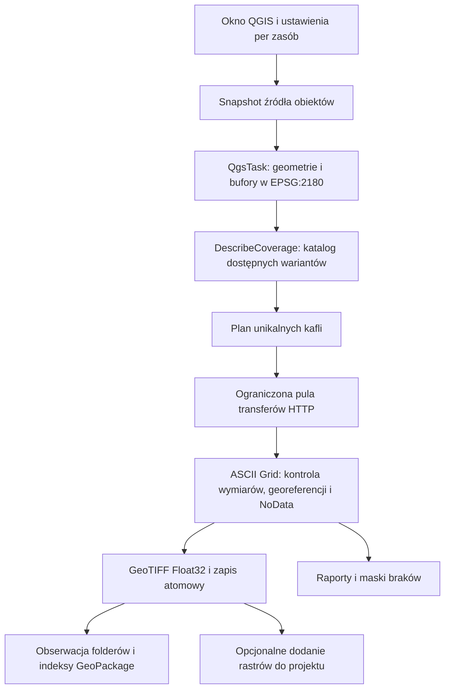

# NMT i NMTP ściągacz — dokumentacja budowy, działania i kierunków rozwoju

**Wersja opisywanej wtyczki:** 1.1.0.  
**Data opracowania:** 23 października 2026 r.  
**Odbiorcy:** użytkownik QGIS, programista Python/PyQGIS oraz osoba planująca wdrożenia biznesowe.  
**Skróty:** NMT = model samego terenu, NMPT = model górnej powierzchni terenu, roślinności i zabudowy. Pisownia „NMTP” pozostaje częścią zamówionej nazwy produktu; techniczny skrót zasobu to „NMPT”.

Dokument opisuje działającą implementację i osobno proponowane rozszerzenia. Pomysły i przykłady analityczne z suplementu nie są funkcjami dostarczonymi w ZIP-ie 1.1.0.

## Spis treści

1. Ocena dostarczonego raportu.
2. Co robi wtyczka i jak jej używać.
3. Środowisko programistyczne i odtworzenie projektu.
4. Architektura oraz uzasadnienie decyzji.
5. Algorytm planowania, wyboru wariantów i pobierania.
6. Indeksy kafli, raporty i diagnostyka.
7. Testy, pakowanie, instalacja i rozwój kodu.
8. Suplement A: konkretne zastosowania biznesowe.
9. Suplement B: dodatkowe, mniej oczywiste dane.
10. Suplement C: przykłady Pythona i plan wdrożenia.
11. Suplement D: plan rozwoju produktu i granice obecnej wersji.
12. Suplement E: plan widoczności turbin — NMT, lokalne NMPT i 3D.
13. Bibliografia.

## 1. Czy ostatnie pobieranie poszło poprawnie?

**Tak — według spójnych raportów wtyczki zakończyło się powodzeniem.** Sprawdzono `report.json`, `report.md`, `events.jsonl` oraz GeoJSON obszarów problemowych. Poniższe zestawienie nie zawiera ścieżek lokalnych, nazwy warstwy, identyfikatora obiektu ani geometrii inwestycji.

| Wskaźnik | Wynik | Interpretacja |
|---|---:|---|
| Stan końcowy | `completed` | Kolejka ukończona bez końcowych braków/błędów |
| Zaplanowane / rozpatrzone kafle | 29 / 29 | Liczniki są spójne z listą wyników |
| NMT | 8 plików, piksel 1 m | Zastosowano zamiennik względem preferowanych 5 m |
| NMPT | 21 plików, piksel 0,5 m | Wybrano rozdzielczość źródłową |
| Układ wysokościowy wszystkich wyników | PL-EVRF2007-NH | Nie było potrzeby użycia KRON86 |
| NoData wewnątrz żądanego obszaru | 0 pikseli | W granicach kontroli opartej na środkach pikseli |
| Końcowe błędy / pominięte geometrie | 0 / 0 | Wszystkie wyniki mają stan `downloaded` |
| Zerwane połączenia | 3 | Każde ponowienie zakończyło się sukcesem, maksymalnie 2 próby |
| Błędy dodatkowego katalogu GRID5 | 2 × HTTP 401 | Nie dotyczyły publicznych wariantów GRID1 |
| Transfer | 627,82 MB | Dane numeryczne ASCII, wliczane są także ponowienia |
| Pliki wynikowe | 11,96 MB | Skompresowane GeoTIFF-y, zgodnie z zapisanymi rozmiarami |
| Czas | 1014,84 s ≈ 16 min 55 s | Ustawiono jedno pobieranie równoległe |
| Obszary problemowe | pusta kolekcja GeoJSON | Brak końcowych obszarów wymagających uwagi |

**Dlaczego NMT ma 1 m, skoro wybrano 5 m?** Dodatkowy endpoint GRID5 zwrócił 401. Tryb „Tylko wybrana rozdzielczość” był wyłączony, więc wtyczka poprawnie użyła dostępnego wariantu 1 m. To nie jest błąd pobierania. Zamiana jest jawnie zapisana w raporcie. Rozmiar piksela 1 m nie stanowi sam w sobie deklaracji dokładności pionowej 1 m.

**Czy użyto drugiego układu?** Nie. Chociaż opcja była dozwolona, wszystkie wybrane pliki mają EVRF2007. Flaga `fallback_used` w ośmiu wynikach NMT dotyczy zmiany rozdzielczości, nie zmiany układu wysokościowego.

**Dlaczego transfer jest znacznie większy od plików na dysku?** Usługa zwraca tekstowe liczby dla pełnych kafli. Dopiero lokalnie następuje konwersja i kompresja. Dodatkowo kafle na brzegu wykraczają poza bufor. W tym zadaniu analizowany obszar wynosił około 3,14 km², podczas gdy pełne kafle obejmowały około 8,39 km² NMT i 5,51 km² NMPT. Te dwa zbiory mogą się przestrzennie pokrywać; ich powierzchni nie należy dodawać jako powierzchni inwestycji.

**Co potwierdza ten audyt?** Spójność przebiegu i wyników zgłoszonych przez wtyczkę. Same pliki GeoTIFF, indeksy GeoPackage ani projekt QGIS nie były dołączone, więc niezależnie nie odczytano ich pikseli ani nie potwierdzono działania widoku mapy na tym komputerze. Nie wynika z tego także dokładność geodezyjna, aktualność wszystkich pomiarów czy kompletność bardzo wąskich obiektów, np. przewodów.

## 2. Funkcjonalność i instrukcja użytkowania

### 2.1. Przygotowanie wejścia

1. Dodaj do QGIS warstwę wektorową z poprawnie opisanym CRS.
2. Wskaż ją we wtyczce. Może zawierać punkty, linie lub poligony.
3. Dla wybranych obiektów włącz „Tylko zaznaczone obiekty”. Bez tej opcji używana jest cała warstwa.
4. Wpisz promień w metrach. Dla 20 km wpisz `20000`, dla 1 km `1000`.
5. Dla punktów i linii promień musi być większy od zera. Dla poligonu 0 oznacza jego własny obszar.

Bufor powstaje wokół całej geometrii obiektu. Trzy sąsiednie działki mogą mieć nakładające się bufory, ale ten sam kafel jest planowany tylko raz dla danego zasobu.

### 2.2. Osobne ustawienia danych

Dla NMT i NMPT ustaw niezależnie:

- czy pobierać zasób;
- folder wyników;
- preferowaną rozdzielczość źródłową;
- czy wolno zastąpić ją najbliższą dostępną;
- preferowany układ wysokościowy;
- czy przy brakach wolno sprawdzić drugi układ.

„Sprawdź dostępne rozdzielczości i układy” odświeża listę z usług. Każde pobieranie i tak sprawdza dostępność ponownie. Listy nie stanowią obietnicy, że każdy wariant ma dane w każdym punkcie kraju.

Domyślnie preferowany jest EVRF2007. Opcja drugiego układu jest wyłączona. Jeżeli potrzebujesz jednorodnego modelu do analiz, pozostaw jeden układ. Samo dopisanie EPSG:2180 do rastra nie transformuje wysokości między EVRF2007 a KRON86: EPSG:2180 opisuje tu geometrię poziomą.

### 2.3. Pobieranie, indeksy i mapa

1. Ustaw różne foldery NMT/NMPT i folder raportów.
2. Wybierz wielkość kafla, domyślnie 1024 × 1024 piksele, oraz równoległość 1–4, domyślnie 2.
3. Kliknij „Pobierz”. Przy pierwszym dużym zadaniu zacznij od mniejszego obszaru i 1–2 pobrań naraz; większa równoległość nie gwarantuje proporcjonalnego przyspieszenia usługi.
4. Obserwuj etap, aktywne transfery, postęp, MB i szacunkowe ETA. Ukrycie okna nie przerywa pracy.
5. Po ukończeniu otwórz raport. „Pokaż pobrane rastry na mapie” dodaje poprawne pliki do projektu; nie trzeba robić tego podczas samego pobierania.
6. „Pokaż / odśwież indeksy folderów” buduje także indeks dla wcześniej pobranych plików.

Warstwy „Pobrane kafle NMT” i „Pobrane kafle NMPT” pokazują obrysy plików na dysku. Po dodaniu, usunięciu lub podmianie rastra indeks się zmienia. Zapisz projekt, jeżeli ma pamiętać indeksy. Po ponownym uruchomieniu synchronizacja wymaga włączonej wtyczki.

### 2.4. Interpretacja wyników

GeoTIFF-y obejmują pełne kafle; nie są automatycznie przycinane do kształtu bufora ani łączone w jeden raster. Rozdzielczość, układ i siatka są zakodowane w nazwie. Indeks oznacza istnienie pliku, nie gwarancję ważnych danych w każdym jego pikselu.

Kafle są siatką utworzoną przez wtyczkę, a nie kopią numeracji arkuszy Geoportalu. Zawartość pochodzi z numerycznej usługi WCS. Bieżąca wersja nie wybiera roku nalotu, konkretnego archiwalnego arkusza ani konkretnego wykonawcy pomiaru.

## 3. Odtworzenie i rozwijanie wtyczki

### 3.1. Repozytorium i struktura

Kod źródłowy: [gałąź codex/nmt-nmtp-sciagacz](https://github.com/misinskimichal/pobieracz_danych_gugik/tree/codex/nmt-nmtp-sciagacz). Analiza implementacji odnosi się do kodu wtyczki z commitu `890e57c93fbd215e12d3b68b53af3d72b0897756`; kolejne commity dokumentacyjne nie muszą zmieniać aplikacji.

```text
pobieracz_danych_gugik/
├── nmt_nmpt_downloader/
│   ├── __init__.py       # punkt wejścia classFactory
│   ├── metadata.txt      # nazwa, wersja, zgodność QGIS
│   ├── plugin.py         # okno, ustawienia, QgsTask i sygnały Qt
│   ├── catalog.py        # warianty źródeł i reguły zastępowania
│   ├── core.py           # geometrie, kafle, walidacja rastrów, konwersja
│   ├── engine.py         # przebieg zadania, HTTP, retry, raporty
│   ├── coverage.py       # indeksy folderów i dodawanie rastrów
│   ├── icon.svg
│   ├── README.md
│   └── LICENSE
├── tests_nmt_nmpt/test_downloader.py
├── docs/                 # ten dokument i przykłady analityczne
└── releases/             # instalowalne ZIP-y
```

Jest to oddzielny pakiet QGIS w repozytorium zawierającym także projekt źródłowy „Pobieracz danych GUGiK”. Nowa wtyczka nie wymaga uruchomienia oryginalnej wtyczki. Obie nazwy mogą występować w tym samym repozytorium.

### 3.2. Środowisko

**Najpierw zainstaluj QGIS**, następnie pracuj w jego środowisku Pythona. `pip install qgis` nie zastępuje QGIS Desktop/PyQGIS.

Na Windows wykorzystaj Pythona i konsolę dostarczoną przez instalator QGIS/OSGeo4W. Na Linuksie użyj odpowiednich pakietów dystrybucji; przykładowo w Debianie:

```bash
sudo apt-get update
sudo apt-get install qgis python3-qgis python3-gdal python3-numpy python3-requests python3-lxml
```

Przed instalacją pakietów dopasuj repozytoria systemowe do docelowej wersji QGIS. Powyższe polecenia są instrukcją dla własnego komputera, nie poleceniami wykonanymi podczas tworzenia tego dokumentu.

Szybkie sprawdzenie w konsoli Pythona QGIS:

```python
from qgis.core import Qgis
from osgeo import gdal
import numpy, requests, lxml
print(Qgis.QGIS_VERSION, gdal.VersionInfo(), numpy.__version__)
```

Wersję 1.1.0 sprawdzano z QGIS 3.40.6, Qt5 i Pythonem 3.13 na Linuksie. Metadata dopuszcza QGIS 3.28–3.x; nie przeprowadzono tutaj macierzy testów wszystkich wspieranych wersji. Kod korzysta m.in. z `math.lcm`, więc wymaga Pythona co najmniej 3.9. QGIS 4 nie jest deklarowany jako obsługiwany.

### 3.3. Pobranie źródeł

```bash
git clone --branch codex/nmt-nmtp-sciagacz https://github.com/misinskimichal/pobieracz_danych_gugik.git
cd pobieracz_danych_gugik
```

Używaj istniejącego checkoutu, jeżeli już go masz. Do zwykłego rozwijania tej wtyczki nie trzeba tworzyć dodatkowych Git worktree. Przy pracy zespołowej zmiany funkcjonalne warto wprowadzać na oddzielnej gałęzi i porównywać z testowaną wersją bazową.

### 3.4. Minimalny punkt wejścia

QGIS szuka w katalogu pakietu pliku `metadata.txt` oraz funkcji `classFactory`:

```python
# nmt_nmpt_downloader/__init__.py
def classFactory(iface):
    from .plugin import TerrainPlugin
    return TerrainPlugin(iface)
```

`iface` daje dostęp do okna QGIS, menu, warstwy aktywnej i mapy. `TerrainPlugin.initGui()` rejestruje akcję, a `unload()` usuwa akcję, zatrzymuje obserwator indeksów i anuluje uruchomione zadania. Okno nie wykonuje sieciowych żądań w głównym wątku.

Nie należy zastępować właściwego pakietu samym powyższym fragmentem: pełną implementację stanowią wymienione pliki źródłowe.

### 3.5. Cykl tworzenia nowej funkcji

1. Zdefiniuj wymaganie i kryterium wyniku, np. „usunięcie pliku usuwa jeden obrys z indeksu”.
2. Rozdziel logikę od GUI: reguła do `catalog.py`/`core.py`, przebieg do `engine.py`, prezentacja do `plugin.py`.
3. Zadbaj o anulowanie i raportowanie błędów. Pojedynczy błąd danych nie powinien blokować innych kafli.
4. Utwórz test na małych sztucznych danych, w tym przypadek awarii.
5. Sprawdź małe reprezentatywne żądanie do usługi rzeczywistej.
6. Zwiększ wersję w `metadata.txt` i `core.VERSION`, jeżeli zmieniła się aplikacja.
7. Zbuduj ZIP, przetestuj jego instalację/ładowanie i dopiero potem udostępnij.

Licencja pakietu to GPL-3.0. Zachowaj plik licencji i sprawdzaj zgodność licencji bibliotek oraz danych dołączanych w przyszłości. Sam dostęp przez HTTP nie jest deklaracją dowolnego prawa do redystrybucji danych.

## 4. Architektura i uzasadnienie zastosowanych rozwiązań



| Rozwiązanie | Co daje użytkownikowi | Dlaczego wybrano je tutaj |
|---|---|---|
| PyQGIS i Qt | Warstwy z bieżącego projektu, standardowe zadania QGIS | Brak konieczności osobnej aplikacji lub serwera |
| `QgsVectorLayerFeatureSource` | Praca na snapshotcie danych wejściowych | Worker nie powinien korzystać bezpośrednio z obiektu warstwy GUI |
| `QgsTask` + sygnały Qt | Responsywny interfejs | Postęp i zakończenie są przekazywane bez manipulowania widgetami z workerów |
| `ThreadPoolExecutor` | Kilka ograniczonych transferów równolegle | Sieć jest głównie zadaniem I/O, a nie tysiącami nieograniczonych wątków |
| Metryczny CRS EPSG:2180 | Promień rzeczywiście podawany w metrach | Bufor w stopniach nie odpowiada promieniowi 20 km |
| Przygotowane geometrie GEOS + indeks przestrzenny | Mniej obliczeń dla dużych warstw | Testy przecięć i wybór geometrii kafla są lokalne |
| WCS `DescribeCoverage` | Jawny faktyczny piksel i zasób | Nie zakładamy, że wariant istnieje tylko dlatego, że jest w formularzu |
| WCS 1.0.0 / ASCII Grid | Numeryczne wartości wysokości | W sprawdzonym żądaniu WCS 2.0.1 `image/tiff` dawało Byte i zaokrąglone wartości |
| GeoTIFF Float32 + DEFLATE | Małe, standardowe pliki do GIS | Zachowujemy ułamkowe wartości, kompresja DEFLATE jest bezstratna dla zapisanych wartości |
| Pełne kafle o stałej siatce | Ponowne użycie danych przy kolejnym buforze | Przycięcie każdego pliku do poprzedniego AOI ograniczyłoby cache |
| Plik tymczasowy i atomowa zamiana | Uszkodzony transfer nie wygląda jak gotowy wynik | Publikowany plik pojawia się dopiero po kontroli |
| Sygnatura żądania | Ochrona przed użyciem pliku dla innych parametrów | To skrót parametrów, nie podpis kryptograficzny samej zawartości rastra |
| GeoPackage dla indeksu | Trwałe warstwy zapisujące się z projektem | Warstwa pamięciowa utraciłaby obrysy po restarcie |
| Watcher + okresowy skan | Aktualizacja po zmianach dysku | Same zdarzenia systemowe nie gwarantują wykrycia każdej podmiany |
| JSON + Markdown + JSONL | Analiza maszynowa, czytelne podsumowanie i dziennik | Jeden format nie spełnia dobrze wszystkich trzech zastosowań |

Float32 jest świadomym ograniczeniem reprezentacji: tekstowe liczby mogą mieć więcej cyfr niż sensowne dla danych wysokościowych. Przykładowe wartości setek metrów są reprezentowane znacznie dokładniej niż centymetr, ale nie jest to obietnica dokładności pomiarowej. Zmiana formatu nie poprawia jakości źródła.

## 5. Szczegółowy algorytm działania

### 5.1. Geometrie i bufor

Wątek GUI pobiera źródło warstwy i kopię kontekstu transformacji projektu. W zadaniu:

1. stosowany jest filtr zaznaczonych ID, jeśli go wybrano;
2. geometria jest kopiowana i transformowana do EPSG:2180;
3. niepoprawna geometria jest naprawiana przez `makeValid()`;
4. dla dodatniego promienia tworzony jest bufor z 64 segmentami na ćwiartkę okręgu;
5. puste lub nadal błędne geometrie trafiają do `input_issues`;
6. pozostałe geometrie są indeksowane przestrzennie.

Bufor i rasteryzacja są przybliżeniami numerycznymi. Weryfikacja NoData dotyczy środków pikseli wewnątrz bufora, a nie każdej nieskończenie małej części granicy.

### 5.2. Katalog wariantów

`Engine.discover()` odpytuje znane endpointy i oba układy. Ma oddzielną pulę maksymalnie trzech zadań katalogowych. `parse_description()` rozpoznaje nazwę zasobu, zasięg w EPSG:2180, wektory kroku siatki i dostępność numerycznego ASCII Grid.

- NMT GRID1: `https://mapy.geoportal.gov.pl/wss/service/PZGIK/NMT/GRID1/WCS/DigitalTerrainModel`
- NMPT GRID1: `https://mapy.geoportal.gov.pl/wss/service/PZGIK/NMPT/GRID1/WCS/DigitalSurfaceModel`
- Opcjonalny NMT GRID5: analogiczna ścieżka z `GRID5`.

Używane identyfikatory to `DTM_PL-EVRF2007-NH`, `DTM_PL-KRON86-NH`, `DSM_PL-EVRF2007-NH` i `DSM_PL-KRON86-NH`, jeżeli zostaną potwierdzone przez usługę. `Orthoimagery` nie jest identyfikatorem tych modeli.

`catalog.py` nie przeszukuje całego internetu i nie omija uwierzytelniania. Błąd dodatkowego endpointu jest zapisywany w `catalog_errors`, a dostępne warianty działają dalej.

### 5.3. Ranking wariantów

`choose_variants()` stosuje reguły w tej kolejności:

1. usuwa drugi układ, jeśli nie ma zgody na jego użycie;
2. w trybie ścisłym usuwa inne rozdzielczości;
3. preferuje zadany układ wysokościowy;
4. w obrębie tego układu wybiera najmniejszą różnicę względem żądanego piksela;
5. przy remisie preferuje drobniejszy piksel;
6. przy „Źródłowa” preferuje najmniejszy piksel.

Preferencja układu jest ważniejsza od bliskości rozdzielczości. Dostępność 5 m w drugim układzie nie powoduje automatycznego odrzucenia 1 m w układzie preferowanym. Oba parametry są jawne w raporcie.

Jeżeli pobrany wariant jest niepełny lub błędny, sprawdzane są kolejne dopuszczone. Zachowywane są poprawne pliki, a podsumowanie wybiera wariant z największym procentowym pokryciem. Nie jest wykonywana automatyczna mozaika dopełniająca luki z różnych układów. Dwa częściowe rastry z różnych układów nie stają się potajemnie jednym „100% kompletnym” modelem.

### 5.4. Siatka kafli

Dla piksela `r` i liczby pikseli boku `p` bok kafla wynosi `s = r × p`. Kafle są wyrównane do globalnej siatki o początku 0 w EPSG:2180:

```text
xmin = x * s       xmax = (x + 1) * s
ymin = y * s       ymax = (y + 1) * s
```

Kandydaci powstają przy każdej geometrii, nie w jednym wielkim prostokącie między wszystkimi odległymi obiektami. Kafel trafia do planu, jeśli ma dodatnie przecięcie z buforem. Klucz zasób/x/y usuwa duplikaty.

Gdy warianty mają różne piksele, wspólny bok jest wyrównywany do wspólnego kroku ich siatek. Wariant zastępczy pokrywa dzięki temu ten sam prostokąt, choć może mieć inną liczbę pikseli. Limit planu to 100 000 kafli; zbyt duże zadanie wymaga podziału albo innej konfiguracji.

### 5.5. Żądanie i transfer

Przykładowe parametry, z ilustracyjnym małym BBOX:

```text
SERVICE=WCS
VERSION=1.0.0
REQUEST=GetCoverage
COVERAGE=DTM_PL-EVRF2007-NH
CRS=EPSG:2180
RESPONSE_CRS=EPSG:2180
BBOX=637000,486000,637064,486064
RESX=1
RESY=1
FORMAT=image/x-aaigrid
```

Plik pobierany jest strumieniowo fragmentami 65 536 bajtów. Połączenie ma timeout 10 s, odczyt 90 s; nie jest to limit całego czasu transferu. Sprawdzana jest długość odpowiedzi, jeśli nagłówki pozwalają ją porównać. Rozmiar odpowiedzi ma limit zależny od liczby pikseli.

Maksymalnie trzy próby są oddzielone oczekiwaniem 1 s i 2 s. Błędy plików HTTP 4xx poza 408/429 nie są ponawiane. Stałe 400/401/403/404 w katalogu także kończą próbę tego wariantu. Weryfikacja certyfikatu TLS jest włączona.

XML z błędem WCS może przyjść z HTTP 200. Dlatego nie wystarcza sam status HTTP: zawartość jest rozpoznawana, a XML parsowany z wyłączonymi encjami zewnętrznymi i bez sieciowego dołączania zasobów.

### 5.6. Walidacja i zapis

`inspect_raster()` sprawdza:

- czy GDAL otworzył plik i odczytał piksele;
- liczbę kanałów oraz szerokość/wysokość;
- oczekiwaną georeferencję i piksel;
- zgodność sygnatury dla plików istniejących;
- wartości NaN/Inf i NoData wewnątrz maski AOI.

Ważna uwaga: to nie jest niezależna weryfikacja dokładności pionowej ani daty pomiaru. Bieżąca funkcja nie wykonuje pełnego audytu pionowego CRS. Numeryczny ASCII może nie mieć własnej pełnej deklaracji CRS; znany CRS odpowiedzi jest ustawiany przy konwersji.

GeoTIFF jest zapisywany z opcjami `Float32`, `COMPRESS=DEFLATE`, `PREDICTOR=3`, `TILED=YES`, `NUM_THREADS=1`. Liczba wątków kompresji jest ograniczona, aby kilka równoległych kafli nie mnożyło niekontrolowanie obciążenia CPU. Po ponownej kontroli plik tymczasowy zastępuje plik docelowy.

Rastry całkowicie pozbawione ważnych pikseli w AOI nie są publikowane jako gotowe modele. Częściowe są zachowywane wraz z maską braków. Przerwanie zadania usuwa znane bieżące pliki tymczasowe, a zakończone kafle pozostają do wznowienia.

### 5.7. Cache i współbieżność

Nazwa pliku zawiera zasób, układ, piksel, liczbę pikseli i indeks x/y. `REQUEST_SIGNATURE` jest SHA-256 parametrów źródła, zasobu, zasięgu, rozdzielczości i CRS. Nie jest sumą kontrolną pikseli; do silnego audytu integralności plików warto w przyszłości dodać osobne SHA-256 zawartości.

Sprawdzony plik może być użyty ponownie dla innego bufora, ponieważ przechowuje pełny kafel. Cache nie dowodzi, że GUGiK nie opublikował nowszych danych. Aby odświeżyć źródło, wyłącz pomijanie plików.

Blokada folderu jest tworzona atomowo przez `O_EXCL`. Dwa zadania nie powinny nadpisywać tej samej kolekcji. Po awarii blokada może pozostać; przed ręcznym usunięciem trzeba upewnić się, że zadanie już nie pracuje.

## 6. Indeksy i raporty

### 6.1. Schemat indeksu

GeoPackage `.nmt_nmpt_index_NMT.gpkg` lub `.nmt_nmpt_index_NMPT.gpkg`, warstwa `kafle`, zawiera m.in.:

| Pole | Znaczenie |
|---|---|
| `plik`, `sciezka` | Nazwa i rzeczywista ścieżka pliku |
| `zasob` | NMT lub NMPT |
| `piksel_m` | Piksel w metrach dla wyjścia EPSG:2180 |
| `uklad_wys` | Odczytany układ lub „nieznany” |
| `rozmiar_MB` | Rozmiar pliku, MB dziesiętne |
| `mtime_ns`, `bajty` | Stan pliku wykorzystywany do przyrostowego skanowania |

GeoPackage dodaje własny klucz `fid`. Kod przypisuje atrybuty po nazwach/indeksach pól, aby dodatkowy `fid` nie przesunął kolumn.

### 6.2. Synchronizacja

`QFileSystemWatcher` obserwuje folder, a zdarzenia są grupowane przez 750 ms. Timer uruchamia też skan co 15 s. Skan działa w `ScanTask`, czyta nagłówki tylko nowych lub zmienionych plików, porównując czas modyfikacji i liczbę bajtów. Nie wykonuje pełnego haszowania ani przeliczania wszystkich pikseli.

Pliki `.tif`, `.tiff` i `.asc` są uwzględniane bezpośrednio w folderze. Podfoldery i pliki tymczasowe są pomijane. Dla nieczytelnego zmienionego pliku stary obrys może chwilowo pozostać, aby zapis w trakcie nie powodował migotania indeksu. Błędy trafiają do komunikatów QGIS.

Zmiany GeoPackage są wykonywane w głównym wątku i zatwierdzane transakcyjnie. Custom properties warstwy zapamiętują folder i zasób. Przy ponownym odczycie projektu `restore()` rejestruje obserwację. Wyłączenie wtyczki zatrzymuje timery; nie usuwa danych.

### 6.3. Pliki diagnostyczne i stany

| Plik / stan | Rola |
|---|---|
| `report.json` | Pełne parametry i wyniki, także `alternatives` oraz `files` |
| `report.md` | Czytelne podsumowanie |
| `events.jsonl` | Kolejne zdarzenia z czasem UTC, bez potrzeby doczytania całego JSON |
| `obszar.geojson` | Bufory w EPSG:4326 |
| `obszary_problemowe.geojson` | Fragmenty kafli wymagające uwagi, nie dokładny kształt każdej dziury |
| `masks/*_braki.tif` | Dokładna maska NoData: 1 = brak, 0 = poza brakami |
| `downloaded` / `reused` | Nowy transfer / ponownie użyty poprawny plik |
| `partial` / `missing` | Częściowe NoData / same NoData w AOI |
| `failed` | Nie udało się zweryfikować danych; nie dowodzi braku zasobu |
| `canceled` | Przerwano zadanie lub kolejkę |
| `outside_pixels` | AOI nie zawiera środka piksela danej rozdzielczości |

Raport jest aktualizowany okresowo, nie po każdym bajcie. Po nagłym wyłączeniu komputera dziennik i stan plików mogą zawierać więcej informacji niż ostatni checkpoint JSON. Pliki raportów mogą zawierać ścieżki i obszar inwestycji — przed publicznym udostępnieniem warto je zanonimizować.

### 6.4. MB i ETA

W GUI:

- licznik pobranych bajtów obejmuje odczytane fragmenty HTTP i ponowienia;
- pliki z cache nie zwiększają nowego transferu;
- początkowy szacunek rozmiaru kafla opiera się na 22 bajtach na piksel ASCII;
- później używana jest średnia z maksymalnie 30 zakończonych próbek;
- ETA dzieli szacowany pozostały transfer przez średnią prędkość od początku transferów;
- walidacja, kompresja, kolejne błędy i zmiany wariantu mogą wydłużyć rzeczywisty czas.

Pasek postępu uwzględnia ukończone kafle i część aktywnych transferów. ETA pozostaje oszacowaniem, a nie rezerwacją przepustowości serwera.

## 7. Weryfikacja, pakowanie i utrzymanie

### 7.1. Testy

Z katalogu głównego repozytorium, w Pythonie mającym PyQGIS:

```bash
QT_QPA_PLATFORM=offscreen PYTHONDONTWRITEBYTECODE=1 /usr/bin/python3 -m unittest discover -s tests_nmt_nmpt -v
```

W środowisku z katalogiem domowym tylko do odczytu ustaw także `XDG_CONFIG_HOME`, `XDG_CACHE_HOME` i `XDG_DATA_HOME` na własne zapisywalne katalogi. W Windows uruchom testy w środowisku QGIS; składnia ustawiania zmiennych zależy od konsoli.

Sprawdzona wersja 1.1.0 ma **18 testów zakończonych poprawnie**. Obejmują m.in. deduplikację, filtr zaznaczenia, bufor metryczny z EPSG:4326, dokładne i najbliższe warianty, fallback układu z zachowaniem zasięgu, NoData, XML błędu z HTTP 200, HTTP 503/404, ponowienia, cache, anulowanie, ochronę obcych plików, aktualizację indeksu po dodaniu/usunięciu/podmianie, zapis/odczyt projektu i cały przebieg GUI → pobranie → indeksy → mapa.

Lokalny serwer testowy zastępuje WCS. To pozwala deterministycznie sprawdzać awarie bez obciążania Geoportalu. Oddzielnie wykonano małe rzeczywiste pobrania obu modeli. Test użytkownika opisany w rozdziale 1 dostarcza dodatkowego dowodu działania pobierania na jego komputerze, ale nie zastępuje pełnej macierzy systemów i wersji QGIS.

Dodatkowe kontrole jakości:

```bash
flake8 --config=.flake8 .
bandit -ll -r nmt_nmpt_downloader
```

W czasie przygotowania dokumentacji zweryfikowano także przykłady nDSM, nachylenia, widoczności terenowej i radiolinii na danych syntetycznych oraz obliczenie PV na modelu bezchmurnego dnia. Nie wykonano modelu rzeczywistej farmy wiatrowej, analizy powodziowej ani pozyskania wszystkich dodatkowych danych z suplementu.

### 7.2. Budowa ZIP-a

Archiwum musi zawierać katalog `nmt_nmpt_downloader/`, a dopiero w nim `metadata.txt` i `__init__.py`. Nie pakuj całego repozytorium jako jednej wtyczki. Nie dołączaj raportów klienta, danych, środowiska wirtualnego ani `__pycache__`.

Przykład uruchamiany z katalogu głównego repozytorium:

```python
from pathlib import Path
from zipfile import ZipFile, ZIP_DEFLATED
import configparser
import hashlib

root = Path('nmt_nmpt_downloader')
config = configparser.ConfigParser()
config.read(root / 'metadata.txt', encoding='utf-8')
version = config['general']['version']
output = Path('releases') / f'NMT i NMTP ściągacz-{version}.zip'
output.parent.mkdir(exist_ok=True)
allowed = {'.py', '.svg', '.md', '.txt'}
with ZipFile(output, 'w', compression=ZIP_DEFLATED) as archive:
    for path in sorted(root.iterdir()):
        if path.is_file() and (path.suffix in allowed or path.name == 'LICENSE'):
            archive.write(path, str(Path(root.name) / path.name))
with ZipFile(output) as archive:
    assert archive.testzip() is None
    assert f'{root.name}/metadata.txt' in archive.namelist()
    assert f'{root.name}/__init__.py' in archive.namelist()
print(output, hashlib.sha256(output.read_bytes()).hexdigest())
```

Sprawdzenie CRC ZIP-a nie zastępuje uruchomienia wtyczki. Test dystrybucji powinien użyć **właśnie utworzonego archiwum**, sprawdzić odczyt metadata przez QGIS, `loadPlugin`, `classFactory`, `initGui`, otwarcie okna i `unload`.

### 7.3. Instalacja i publikacja

QGIS → Wtyczki → Zarządzanie wtyczkami → Zainstaluj z ZIP. Przy aktualizacji zakończ zadania i zrestartuj QGIS, aby wyładować stare moduły. Foldery danych pozostają niezależne od folderu instalacji.

[ZIP 1.1.0 do pobrania](https://github.com/misinskimichal/pobieracz_danych_gugik/raw/refs/heads/codex/nmt-nmtp-sciagacz/releases/NMT%20i%20NMTP%20%C5%9Bci%C4%85gacz-1.1.0.zip).

SHA-256 opublikowanej paczki 1.1.0:

```text
0f4c25d7f7e62b129caf8847b791a3f779f48853a21666077c93a7e18edccc99
```

Ponowne zbudowanie identycznych źródeł może dać inny skrót ZIP-a przez daty wpisów archiwum. Do porównania wydania używaj opublikowanego pliku lub wprowadź w przyszłości deterministyczne pakowanie.

Przed publikacją nowej wersji skontroluj skład archiwum i brak danych klienta. Umieszczenie pliku na gałęzi GitHub nie jest publikacją w oficjalnym repozytorium wtyczek QGIS; to odrębna ścieżka dystrybucji.

# Suplement A. Możliwe zastosowania biznesowe

Poniższe kierunki są propozycjami rozwoju, nie obietnicą wyników obecnej wtyczki. Najlepszy pierwszy produkt zwykle łączy dane wysokościowe z informacją o konkretnej inwestycji i daje powtarzalny raport porównujący warianty. Sama mapa wysokości jest łatwiejsza do zastąpienia niż dobrze zdefiniowany proces decyzyjny.

## A1. Wysokie budowle: widoczność masztu, turbiny, komina lub wieżowca

**Prosto:** sprawdzamy, z których miejsc planowany obiekt będzie widoczny i jak zmienia krajobraz. Klientem może być deweloper, operator telekomunikacyjny, inwestor wiatrowy lub zespół projektujący komin przemysłowy.

**Produkt:** mapa potencjalnej widoczności, liczba budynków/obserwatorów w zasięgu, porównanie wysokości np. 80/120/160 m i kilka realistycznych punktów widokowych. Dane dodatkowe: budynki 3D, lasy, obiekty chronione i rzeczywiste pozycje obserwatorów.

**Implementacja:** najpierw [GDAL Viewshed](https://gdal.org/en/stable/programs/gdal_viewshed.html) / [OSGeo/gdal](https://github.com/OSGeo/gdal) dla ukształtowania terenu; następnie przecięcia promieni z modelem zabudowy/roślinności w [trimesh](https://github.com/mikedh/trimesh). Wizualizacja wyników: [PyVista](https://github.com/pyvista/pyvista).

**Kod:** funkcja `terrain_viewshed()` w C2. Wykorzystuje NMT i odpowiada na pytanie o przesłanianie przez teren, bez przesłaniania budynkami i drzewami. Nie należy w raporcie klienta nazywać tego kompletnym fotorealistycznym ZTV. Obserwator ma wysokość nad powierzchnią wskazanego modelu; dla bardziej szczegółowego DSM trzeba osobno prawidłowo ustalić poziom terenu pod obserwatorem i odbiorcą. Analiza 20 km wymaga ciągłego rastra pokrywającego całe sąsiedztwo, nie tylko pojedynczego małego kafla.

**Uzasadnienie biznesowe:** tańsze porównanie lokalizacji przed kosztowną dokumentacją i wizją terenową. Wskaźniki odbioru: powtarzalność wariantów, zgodność z kontrolnymi punktami widokowymi, jawna wysokość obiektu i założenia refrakcji.

## A2. Maszty telekomunikacyjne: profil radiolinii i strefa Fresnela

**Prosto:** sama prosta między antenami nie wystarcza; wokół niej musi pozostać zapas przestrzeni. Drzewo może nie przecinać prostej, a mimo to pogarszać łącze.

**Produkt:** profil terenu i przeszkód, minimalny prześwit, sugerowana wysokość anteny i ranking par lokalizacji. NMT daje poziom gruntu, NMPT przybliża zabudowę i roślinność, a LiDAR pozwala dokładniej analizować przeszkody.

**Implementacja:** próbkowanie profilu w [Rasterio](https://github.com/rasterio/rasterio) albo GDAL, geodezja/transformacje w [pyproj](https://github.com/pyproj4/pyproj), obliczenia w NumPy. Funkcja `radio_clearance()` w C2 uwzględnia geometryczny prześwit 60% pierwszej strefy Fresnela i model efektywnego promienia Ziemi.

**Granica wyniku:** to kontrola geometryczna, nie pełny model propagacji. Następny etap powinien uwzględniać dyfrakcję, straty roślinności, częstotliwość, pogodę, anteny i odpowiednią metodę ITU-R. Założenie efektywnego promienia 4/3 Ziemi jest parametrem, nie stałą atmosfery.

**Uzasadnienie biznesowe:** szybka eliminacja słabych wariantów masztów oraz lista miejsc wymagających wizji terenowej zamiast nieukierunkowanych objazdów.

## A3. Energetyka wiatrowa: teren, lokalizacja i układ turbin

**Prosto:** modele wysokości pomagają znaleźć lokalizacje i ocenić przeszkody, ale nie mówią same, ile energii wyprodukuje turbina.

**Produkt:** karta lokalizacji: rzeźba terenu, nachylenia, dostęp, ekspozycja krajobrazowa, potencjalne ograniczenia wysokości oraz porównanie układu turbin po dołączeniu danych wiatrowych.

**Implementacja:** teren i nachylenia z GDAL, obrysy przeszkód z nDSM/LiDAR, dane meteorologiczne przez [ECMWF cdsapi](https://github.com/ecmwf/cdsapi). Krzywe mocy i modele pojedynczej turbiny: [windpowerlib](https://github.com/wind-python/windpowerlib). Oddziaływanie śladów aerodynamicznych i układ farmy: [FLORIS](https://github.com/NatLabRockies/floris), projekt wcześniej publikowany pod adresem NREL/floris.

**Konkretny moduł:** `WindSiteAssessment` przyjmuje punkt turbiny, wysokość piasty, promień analizy, pomiary/serie wiatru i typ turbiny. Zwraca zestaw wskaźników terenu oraz warianty uzysku z jawnie opisanymi danymi wejściowymi. `terrain_slope()` i `terrain_viewshed()` stanowią pierwsze dwie funkcje takiego modułu.

**Co trzeba uzupełnić:** ERA5 to model pogody o ograniczonej rozdzielczości, a nie pomiar na planowanej piaście. FLORIS nie zastępuje modelowania przepływu nad złożonym terenem ani CFD. Przy takim terenie potrzebne są odpowiedni model przepływu i kalibracja pomiarami. Szorstkości aerodynamicznej nie należy utożsamiać wprost z `NMPT − NMT`.

**Uzasadnienie biznesowe:** spójny screening dużej liczby lokalizacji i wskazanie miejsc, w których warto finansować pomiary, projekt dojazdu lub dokładniejsze modelowanie.

## A4. Fotowoltaika: dachy i teren z rzeczywistym zacienieniem

**Prosto:** obliczamy, które powierzchnie mają dostęp do słońca, a nie tylko gdzie jest wolne miejsce. Wysoki budynek lub drzewa mogą istotnie zmienić opłacalność.

**Produkt:** ranking dachów/działek, godziny zacienienia, powierzchnia użytkowa, wstępny uzysk i porównanie wariantów układu paneli.

**Implementacja:** segmentacja dachów z LiDAR/CityGML, nachylenie i azymut połaci, profil horyzontu oraz promienie przez przeszkody. [pvlib-python](https://github.com/pvlib/pvlib-python) służy do położenia słońca, irradiancji i modeli PV; [trimesh](https://github.com/mikedh/trimesh) do geometrii promieni. Dane o promieniowaniu można uzupełnić z [PVGIS JRC](https://re.jrc.ec.europa.eu/pvg_tools/en/).

**Kod:** przykład C3 oblicza pracę 10 kWp dla ilustracyjnego bezchmurnego dnia. Do użycia biznesowego zastąp model bezchmurny wieloletnimi danymi meteorologicznymi, dodaj temperaturę, urządzenia, przesłanianie bezpośrednie oraz osobno wpływ horyzontu na promieniowanie rozproszone. Nachylenie gruntu z NMT nie jest nachyleniem dachu.

**Uzasadnienie biznesowe:** kwalifikacja leadów instalatora, porównywanie dachów portfela nieruchomości i wskazywanie miejsc wymagających skanu lub pomiaru.

## A5. Linie energetyczne: roślinność w korytarzu i priorytety wycinki

**Prosto:** szukamy drzew i koron w pobliżu infrastruktury oraz odcinków, które warto obejrzeć w pierwszej kolejności.

**Produkt:** odcinki ryzyka, obiekty roślinności z wysokością, porównanie kampanii pomiarowych i harmonogram inspekcji/wycinki.

**Implementacja:** normalizacja chmury punktów względem NMT w [PDAL](https://github.com/PDAL/PDAL), czytanie LAZ w [laspy](https://github.com/laspy/laspy), segmentacja koron w [scikit-image](https://github.com/scikit-image/scikit-image), odległości 3D do osi/przewodów z danych operatora. Punkt startowy to nDSM w C2 i pipeline PDAL w C4.

**Ważne rozróżnienie:** NMPT może pokazać koronę, ale nie gwarantuje odtworzenia cienkiego przewodu. Do rzeczywistego prześwitu elektrycznego potrzebne są wiarygodna geometria przewodów, zwis w warunkach pracy, dokładność pomiaru i wymagane odstępy. Ogólnokrajowy LiDAR może nie mieć wystarczającej gęstości lub klas przewodów. Własny nalot korytarzowy jest tu często osobnym elementem usługi.

**Uzasadnienie biznesowe:** cykliczny produkt dla operatora, nie jednorazowa mapa. Metryki odbioru: trafność wykrytych przeszkód i procent odcinków z wystarczającą jakością danych.

## A6. Ciężki transport i budowa: dojazd, platformy dźwigowe i roboty ziemne

**Prosto:** można wcześnie sprawdzić, czy teren jest stromy i gdzie mogą być potrzebne niwelacja, nasypy lub objazd.

**Produkt:** warianty dojazdu dla komponentów turbin, transformatorów i konstrukcji; nachylenia; profile; orientacyjny bilans wykop/nasyp oraz lista miejsc wymagających projektu geotechnicznego.

**Implementacja:** `terrain_slope()` w C2, rastry kosztu trasy, [scikit-image graph](https://github.com/scikit-image/scikit-image) (`route_through_array`) oraz [GeoPandas](https://github.com/geopandas/geopandas) do ograniczeń przestrzennych. Pola wyłączone z ruchu muszą być barierą, a NoData nie może stać się tanią drogą.

Przykładowy start po przygotowaniu rastra kosztu `cost` i poprawnych indeksów start/koniec:

```python
from skimage.graph import route_through_array
path, accumulated_cost = route_through_array(
    cost, start=(row_a, col_a), end=(row_b, col_b),
    fully_connected=True, geometric=True)
```

To rozwiązanie siatkowe nie uwzględnia samo promienia skrętu zestawu, nośności mostu, skrajni, zezwoleń ani prawa do gruntu. NMT nie daje nośności podłoża; do platform i fundamentów potrzebne są badania geotechniczne.

**Uzasadnienie biznesowe:** wcześniejsze oszacowanie kosztów i wykrycie trudnych miejsc przed mobilizacją sprzętu.

## A7. Energetyka i przemysł: odpływ wody oraz screening zalania

**Prosto:** szukamy obniżeń i kierunków spływu, aby wiedzieć, gdzie zbierać dodatkowe dane przed budową stacji, BESS lub placu przemysłowego.

**Produkt:** zlewnie i drogi odpływu, punkty wymagające rozpoznania odwodnienia, porównanie wariantów posadowienia oraz scenariusze zalania po dołączeniu warunków hydrologicznych.

**Implementacja:** analiza zlewni w [pysheds](https://github.com/pysheds/pysheds), a dla modelowania powierzchniowego i scenariuszy powodziowych [HydroMT-SFINCS](https://github.com/Deltares/hydromt_sfincs). Uzupełnij model przepustami, ciekami, wałami, budowlami hydrotechnicznymi i danymi opadowymi/wodowskazowymi.

**Kod:** C5 pokazuje przepływ przygotowania DEM i akumulację. To nie jest mapa prawdopodobieństwa powodzi ani model wydajności kanalizacji. Automatyczne „wypełnianie zagłębień” może usunąć z modelu rzeczywiste zbiorniki lub obiekty retencji; wyniki trzeba sprawdzić względem lokalnej hydrologii.

**Uzasadnienie biznesowe:** wczesne porównanie działek i ograniczenie kosztownych niespodzianek w projekcie odwodnienia.

## A8. Wizualizacja terenu i cyfrowy model inwestycji

**Prosto:** klient widzi obiekt w otoczeniu w przeglądarce lub aplikacji 3D, może porównać warianty i pokazać problem interesariuszom.

**Produkt:** model terenu z projektem turbiny/budynku, przekroje, punkty widokowe, scenariusze przebudowy i przeglądarka całego portfela inwestycji.

**Implementacja:** lokalny prototyp w [PyVista](https://github.com/pyvista/pyvista), geometria i testy kolizji w [trimesh](https://github.com/mikedh/trimesh), publikacja dużych scen przez [CesiumJS](https://github.com/CesiumGS/cesium) i kafle 3D Tiles. Przyda się mesh z teksturą, CityGML i daty nalotów, nie tylko raster wysokości.

**Kod:** `make_terrain_mesh()` w C2 zapisuje VTK StructuredGrid `.vts`, który można otworzyć np. w ParaView. To etap demonstracyjny, a nie gotowy eksporter 3D Tiles.

Przed publikacją globu trzeba uzgodnić układy poziome i wysokościowe. Nie wolno użyć easting/northing EPSG:2180 jako długości/szerokości geograficznej ani bez sprawdzenia potraktować wysokości EVRF2007 jak wysokości elipsoidalnej WGS84. W dużych scenach potrzebne są LOD, decymacja i strumieniowanie; jednorazowe wczytanie miliardów pikseli do siatki jest niepraktyczne.

**Uzasadnienie biznesowe:** szybsze uzgodnienia z klientem, jedna scena dla kilku zespołów i produkt prezentacyjny połączony z analizą.

## A9. Wysokie obiekty i infrastruktura: monitoring ruchów gruntu

**Prosto:** można wykrywać długookresowy sygnał ruchu podłoża w otoczeniu inwestycji i wybierać miejsca do dodatkowego monitoringu.

**Produkt:** panel trendów przemieszczeń, porównanie obiektów i lista obszarów wymagających kontroli geodezyjnej/geotechnicznej.

**Dane i implementacja:** [European Ground Motion Service](https://land.copernicus.eu/en/products/european-ground-motion-service), analiza tabel/serii w pandas i GeoPandas. Własne serie InSAR: [MintPy](https://github.com/insarlab/MintPy), po przygotowaniu odpowiednich interferogramów przez osobny łańcuch przetwarzania.

**Konkretny moduł:** `GroundMotionScreening` łączy lokalizacje obiektów z punktami EGMS, zapisuje referencję produktu, jakość, epokę i składową obserwacji; wyznacza trend i jego niepewność. Nie należy traktować punktów EGMS jak pełnego, jednorodnego pola 3D przemieszczeń.

To nie jest różnica dwóch NMT. Modele wysokości nie służą do potwierdzania milimetrowych osiadań fundamentu. InSAR może mierzyć składową wzdłuż linii obserwacji satelity względem referencji; przeliczenie na ruch pionowy wymaga odpowiednich danych/założeń. Zmiany rozpraszacza i atmosfery także wpływają na interpretację.

**Uzasadnienie biznesowe:** cykliczny monitoring otoczenia i rozsądne kierowanie kosztowniejszych pomiarów in situ, bez przypisywania samemu screeningowi roli ekspertyzy konstrukcyjnej.

## A10. Zmiany terenu, hałdy, nasypy i obiekty przemysłowe

**Prosto:** porównujemy dwie daty i liczymy, gdzie materiał przybył lub ubył. Zastosowania to m.in. place budowy, odkrywki, składowiska i rekultywacja otoczenia infrastruktury.

**Produkt:** mapa zmian, objętości dodatnie/ujemne, wykryte anomalia i historia stanu obiektu.

**Implementacja:** wyrównanie rastrów w GDAL/[Rasterio](https://github.com/rasterio/rasterio), kontrola punktów odniesienia, analiza NumPy; dla chmur [PDAL](https://github.com/PDAL/PDAL). Różnicę liczy się dopiero po uzgodnieniu CRS, pionu, siatki, dat i pokrycia.

Po przygotowaniu zgodnych tablic i wspólnej maski:

```python
import numpy as np
change = after_m - before_m
cell_area_m2 = pixel_x_m * pixel_y_m
added_m3 = float(change[valid & (change > 0)].sum() * cell_area_m2)
removed_m3 = float(-change[valid & (change < 0)].sum() * cell_area_m2)
```

Nierozpoznane przesunięcie pionowe całego nalotu może wyglądać jak ogromna objętość robót. Dobrym rozszerzeniem jest próg istotnej zmiany, np. wyznaczony z błędów obu modeli po usunięciu biasu. Założenia niezależnych błędów i ich korelacja przestrzenna muszą być opisane — niepewność objętości nie jest prostą sumą dowolnie przyjętych „błędów na piksel”.

**Uzasadnienie biznesowe:** rozliczenia i monitoring postępu, o ile jakość oraz metoda pomiaru są odpowiednie do uzgodnionego celu.

# Suplement B. Dodatkowe, mniej oczywiste dane

Nie ma jednego publicznego, kompletnego zestawu dla wszystkich branż. Największą wartość często mają dane o strukturze, dacie i jakości pomiaru oraz własne dane operatora. Poniższa tabela wskazuje konkretne kierunki pozyskiwania. Portal jest punktem wejścia do katalogu, nie obietnicą stabilnego anonimowego API dla wszystkich produktów.

| Dane | Co wnoszą ponad NMT/NMPT | Źródło i sposób pozyskania | Proponowane biblioteki / integracja |
|---|---|---|---|
| Klasyfikowany LiDAR LAS/LAZ | Pojedyncze odbicia, grunt/roślinność/zabudowa; czasem intensywność i klasy specjalistyczne | [Geoportal](https://www.geoportal.gov.pl/): skorowidz WFS, metadane arkusza, link do pliku LAZ; klasy i gęstość sprawdzać w metadanych | [PDAL](https://github.com/PDAL/PDAL), [laspy](https://github.com/laspy/laspy) |
| Mesh 3D z teksturą | Fasady, bryła i wygląd otoczenia, lepsze wizualizacje/kolizje | Geoportal, katalog modeli siatkowych; pliki OBJ/tekstury, lokalne pokrycie zależne od projektu | [trimesh](https://github.com/mikedh/trimesh), [PyVista](https://github.com/pyvista/pyvista), [CesiumJS](https://github.com/CesiumGS/cesium) |
| Budynki CityGML LOD1/LOD2 | Bryły i dachy ze strukturą obiektową, a nie wyłącznie powierzchnia rastra | Geoportal, [katalog Budynki3D](https://opendata.geoportal.gov.pl/InneDane/Budynki3D/); dostępność wersji i LOD z katalogu | GDAL GMLAS/OGR; [citygml4j](https://github.com/citygml4j/citygml4j) dla większego łańcucha Java; Python: lxml do wybranych struktur |
| Skorowidze i daty nalotów/arkuszy | Informacja, czy NMT, NMPT i zdjęcia pochodzą z podobnego czasu | WFS/WMS skorowidzów Geoportalu + metadane produktu; schemat atrybutów przez DescribeFeatureType | [GeoPandas](https://github.com/geopandas/geopandas), requests, OGR; daty jako część manifestu |
| Zdjęcia lotnicze i dane orientacji/aerotriangulacji | Wgląd w geometrię zdjęcia i możliwość dokładniejszej wizualizacji/fotogrametrii | Geoportal, materiały zdjęć lotniczych/aerotriangulacji; zwykle pliki, nie pojedynczy WCS | [GDAL](https://github.com/OSGeo/gdal), pyproj; przetwarzanie fotogrametryczne jako osobny proces z kalibracją kamery |
| Obrazy intensywności LiDAR, wybrane CIR i archiwalne opracowania | Dodatkowa cecha materiału/roślinności i zmiany w czasie | Skorowidze Geoportalu, linki do rzeczywistych rastrów; obraz WMS służy do podglądu, nie zastępuje danych numerycznych | [Rasterio](https://github.com/rasterio/rasterio), NumPy, scikit-image; klasyfikacja po normalizacji i kontroli warunków nalotu |
| Ruchy gruntu EGMS | Długookresowe serie przemieszczeń / prędkości dla odpowiednich rozpraszaczy | [Copernicus EGMS](https://land.copernicus.eu/en/products/european-ground-motion-service); portal, produkty tabelaryczne/wektorowe, możliwe konto i warunki pobrania | pandas, GeoPandas; [MintPy](https://github.com/insarlab/MintPy) dla własnej serii InSAR, nie jako automatyczny czytnik gotowego CSV EGMS |
| Profile pogodowe i szeregi wiatru | Wymuszenie dla analiz energii zamiast wnioskowania o wietrze z samego terenu | [Copernicus Climate Data Store](https://cds.climate.copernicus.eu/), np. ERA5; API, konto, akceptacja warunków produktów | [cdsapi](https://github.com/ecmwf/cdsapi), xarray, windpowerlib, FLORIS |
| Geologia, osuwiska, otwory i wybrane dane geotechniczne | Ograniczenia posadowienia oraz kontekst, którego wysokość powierzchni nie opisuje | [PIG-PIB Geologia](https://geologia.pgi.gov.pl/); właściwe warstwy/usługi i metadane; część materiałów wymaga innych ścieżek dostępu | [GeoPandas](https://github.com/geopandas/geopandas), Shapely, OGR; przecięcia i zapytania przestrzenne, nie automatyczne określanie nośności |
| Głębokości/prędkości wody i elementy ochrony przeciwpowodziowej | Oficjalne scenariusze i warunki modelowania, nie tylko topografia | [Hydroportal / ISOK](https://isok.gov.pl/hydroportal.html); konkretne produkty i warunki pobrania z katalogu | [HydroMT-SFINCS](https://github.com/Deltares/hydromt_sfincs), GDAL/Rasterio, GeoPandas |
| Drzewostany i dane urządzeniowe lasu | Wiek/skład i kontekst wzrostu, przydatne w korytarzach energetycznych | [Bank Danych o Lasach](https://www.bdl.lasy.gov.pl/portal/); usługi/eksporty w zakresie danego produktu | [GeoPandas](https://github.com/geopandas/geopandas), PDAL; połączenie jednostek inwentaryzacyjnych z lokalnym CHM, bez udawania pomiaru każdego drzewa |
| Przeszkody i ograniczenia lotnicze | Ograniczenia wysokości dla turbin, masztów i zabudowy | [PANSA AIS](https://ais.pansa.pl/), właściwe publikacje AIP i warunki wykorzystania; często dokumenty/pliki zamiast WCS | [GeoPandas](https://github.com/geopandas/geopandas) / OGR + kontrolowane parsowanie tabel; sprawdzanie aktualności i rodzaju wysokości |
| Rzeczywista geometria sieci i eksploatacja | Przewody, słupy, temperatury/obciążenia, zwis, moce przyłączeniowe — klucz do wartości biznesowej | Dane operatora/klienta; publiczne informacje [PSE](https://www.pse.pl/dane-systemowe) mają inny zakres niż szczegółowy model sieci | [GeoPandas](https://github.com/geopandas/geopandas), GeoPackage/PostGIS, PDAL; oddzielny autoryzowany adapter do systemu operatora |

Dla materiałów archiwalnych i specjalistycznych zawsze sprawdź: obszar, datę pomiaru, licencję, układ poziomy i pionowy, jednostki, dokładność/gęstość oraz prawa do dalszego udostępniania. Nie zakładaj, że to, co widać w WMS, jest równocześnie dostępne anonimowo jako plik źródłowy. Brak dostępu do jednego produktu nie powinien blokować pozyskiwania innych, publicznych danych.

## B1. Jak dodać takie źródła do tej samej aplikacji

W obecnej wersji zakres jest celowo ograniczony do dwóch zasobów WCS. Dalsze produkty powinny mieć wspólny kontrakt adaptera, a nie dodatkowe instrukcje `if` w oknie.

Przykładowy projekt interfejsu — **propozycja**, nie istniejący moduł 1.1.0:

```python
from dataclasses import dataclass
from typing import Protocol

@dataclass
class Asset:
    identifier: str
    url: str
    bbox: tuple
    acquired_at: str | None
    horizontal_crs: str
    vertical_reference: str | None
    media_type: str
    license_url: str | None

class SourceAdapter(Protocol):
    def discover(self, aoi, preferences) -> list[Asset]: ...
    def estimate_bytes(self, asset: Asset) -> int | None: ...
    def download(self, asset: Asset, destination, progress, cancel): ...
    def validate(self, destination, asset: Asset) -> dict: ...
```

Ten skrót wykorzystuje składnię Pythona 3.10+; jeżeli nowe moduły mają działać także na Pythonie 3.9, zastąp `X | None` przez `Optional[X]`. Interfejs trzeba dostosować do rzeczywistych protokołów i potrzeb paginacji.

- `WcsAdapter`: małe numeryczne wycinki, jak obecnie.
- `WfsFileIndexAdapter`: najpierw obiekty skorowidza i atrybut z linkiem, potem pliki LAZ/GML/OBJ. Typy obiektów i nazwy pól odczytywać ze schematu, nie zgadywać.
- `StacAdapter`: wyszukiwanie scen/zasobów po geometrii, czasie, jakości i typie pliku; [pystac-client](https://github.com/stac-utils/pystac-client). Konkretna kolekcja i nazwy assetów muszą pochodzić z wybranego katalogu.
- `AuthenticatedArchiveAdapter`: kontrolowane pobieranie produktów wymagających konta, bez zapisywania haseł w kodzie lub raportach.
- `OperatorAdapter`: dane prywatnej sieci lub inwestycji, oddzielone od publicznego katalogu i od publicznego repozytorium.

Wspólny manifest powinien opisywać każdy pobrany artefakt: źródło, identyfikator produktu, datę pozyskania danych, datę pobrania, hash pliku, CRS, pion, jednostki, licencję, pokrycie i wynik walidacji. Obecny raport jest dobrym początkiem, ale nie zawiera jeszcze pełnej identyfikacji epoki pomiaru.

# Suplement C. Przykłady Pythona

Przykłady są samodzielnymi punktami startowymi analizy. Nie uruchamiają automatycznie pobierania wszystkich wymienionych danych. Produkty pochodne zapisuj w oddzielnym folderze, żeby indeks pobranych NMT/NMPT nie mieszał ich z materiałem źródłowym.

## C1. Najpierw mozaika i kontrola zgodności

Nie odejmuj tablic tylko dlatego, że obie mają rozszerzenie `.tif`. NMT 1 m i NMPT 0,5 m zwykle mają inne wymiary i granice kafli. Przed porównaniem trzeba uzgodnić projekcję, układ wysokościowy, piksel, zasięg, położenie siatki oraz maski braków. Zgodność pionu nie gwarantuje zgodności dat pomiaru.

Do lekkiej mozaiki można użyć VRT bez kopiowania wszystkich pikseli. Przykład zakłada pliki z metadanymi pionu zapisanymi przez wersję 1.1. Dla starszych plików najpierw potwierdź układ na podstawie ich metadanych źródłowych; nie dopisuj go na podstawie domysłu:

```python
from pathlib import Path
from osgeo import gdal

files = sorted(Path('dane/NMT').glob('NMT_PL-EVRF2007-NH_1m_*.tif'))
if not files:
    raise ValueError('Brak wejściowych plików')
for path in files:
    ds = gdal.Open(str(path))
    if ds is None or ds.GetMetadataItem('HEIGHT_SYSTEM') != 'PL-EVRF2007-NH':
        raise ValueError(f'Nieuzgodniony układ wysokościowy: {path.name}')
    ds = None
vrt = gdal.BuildVRT('nmt.vrt', [str(path.resolve()) for path in files], resolution='highest')
if vrt is None:
    raise RuntimeError('Nie udało się utworzyć mozaiki')
vrt.SetMetadataItem('HEIGHT_SYSTEM', 'PL-EVRF2007-NH')
vrt.FlushCache()
vrt = None
```

Przed włączeniem mieszanych rozdzielczości lub wielu dat zaprojektuj jawne reguły pierwszeństwa w obszarach nakładania. Nie dodawaj bezrefleksyjnie wszystkich wariantów EVRF/KRON i dat do jednej mozaiki.

## C2. nDSM, nachylenie, widoczność, radiolinia i siatka 3D

Pełny plik `terrain_examples.py` jest także w repozytorium pod `docs/examples/`. Funkcje z GDAL i NumPy sprawdzono na sztucznych rastrach. Funkcja PyVista jest przykładem wymagającym dodatkowego VTK/PyVista i nie była uruchamiana w tej weryfikacji.

Przykładowe wywołania:

```python
from terrain_examples import make_ndsm, terrain_slope, terrain_viewshed, radio_clearance

make_ndsm('nmt.vrt', 'nmpt.vrt', 'analizy/ndsm.tif')
terrain_slope('nmt.vrt', 'analizy/nachylenie_stopnie.tif')
terrain_viewshed('nmt.vrt', 'analizy/widocznosc_terenu.tif',
                x=637000, y=486000, observer_agl=120, radius=20000)
print(radio_clearance('profil.csv', frequency_ghz=3.5, mast_a_m=30, mast_b_m=30))
```

Folder `analizy` musi istnieć. Współrzędne są przykładowe i muszą leżeć w rzeczywistym obszarze rastra. Do `profil.csv` przygotuj kolumny `s_m,dtm_m,dsm_m` — odległość wzdłuż profilu i wysokości w jednym układzie. Profile należy próbkować gęsto względem rozmiaru przeszkód; pojedynczy piksel między próbkami może być pominięty.

W nDSM ujemne wartości nie są automatycznie zamieniane na zero, ponieważ mogą wskazywać niezgodność pomiarów lub zmianę terenu. Bilinear wyrównuje siatkę, ale może wygładzać ostre krawędzie; dla szacowania maksymalnej przeszkody trzeba dobrać metodę agregacji/resamplingu do celu. Powstały nDSM ma wysokości względne nad terenem, nie bezwzględne EVRF2007.

```python
"""Small analytical prototypes for correctly registered, metre-based height rasters.

Run with the GDAL/NumPy Python shipped with QGIS. These are analytical examples,
not additional features of plugin 1.1.0. Output files should use a separate folder.
"""
from pathlib import Path
import csv
import math

import numpy as np
from osgeo import gdal, osr


def open_metric_dem(path):
    ds = gdal.Open(str(path), gdal.GA_ReadOnly)
    if ds is None or ds.RasterCount != 1:
        raise ValueError('Oczekiwano jednokanałowego rastra wysokości')
    crs = osr.SpatialReference()
    if crs.ImportFromWkt(ds.GetProjection()) != 0 or not crs.IsProjected():
        raise ValueError('Oczekiwano poprawnego metrycznego CRS')
    if abs(crs.GetLinearUnits() - 1.0) > 1e-9:
        raise ValueError('Jednostką poziomą muszą być metry')
    gt = ds.GetGeoTransform()
    if abs(gt[2]) > 1e-9 or abs(gt[4]) > 1e-9 or gt[1] <= 0 or gt[5] >= 0:
        raise ValueError('Przykład wymaga regularnej siatki north-up')
    return ds


def heights_and_valid(ds):
    band = ds.GetRasterBand(1)
    values = band.ReadAsArray().astype(np.float32)
    valid = np.isfinite(values)
    nodata = band.GetNoDataValue()
    if nodata is not None and math.isfinite(nodata):
        valid &= values != nodata
    return values, valid


def write_float(path, reference, values, valid, product):
    target = gdal.GetDriverByName('GTiff').Create(
        str(path), reference.RasterXSize, reference.RasterYSize, 1, gdal.GDT_Float32,
        options=['TILED=YES', 'COMPRESS=DEFLATE', 'PREDICTOR=3'])
    if target is None:
        raise RuntimeError('Nie można utworzyć pliku wynikowego')
    target.SetGeoTransform(reference.GetGeoTransform())
    target.SetProjection(reference.GetProjection())
    target.SetMetadataItem('SOURCE_HEIGHT_SYSTEM', reference.GetMetadataItem('HEIGHT_SYSTEM') or '')
    target.SetMetadataItem('HEIGHT_REFERENCE', 'relative_above_ground')
    target.SetMetadataItem('PRODUCT', product)
    target.GetRasterBand(1).SetNoDataValue(-9999)
    target.GetRasterBand(1).WriteArray(np.where(valid, values, -9999).astype(np.float32))
    target.FlushCache()
    target = None


def make_ndsm(dtm_path, dsm_path, output):
    """DSM - DTM on the DTM grid; no implicit vertical-datum conversion."""
    dtm, dsm = open_metric_dem(dtm_path), open_metric_dem(dsm_path)
    height = dtm.GetMetadataItem('HEIGHT_SYSTEM')
    if not height or height != dsm.GetMetadataItem('HEIGHT_SYSTEM'):
        raise ValueError('Potwierdź i oznacz zgodny układ wysokościowy obu modeli')
    gt = dtm.GetGeoTransform()
    bounds = [gt[0], gt[3] + gt[5] * dtm.RasterYSize,
              gt[0] + gt[1] * dtm.RasterXSize, gt[3]]
    aligned = gdal.Warp('', dsm, format='MEM', dstSRS=dtm.GetProjection(),
                        outputBounds=bounds, width=dtm.RasterXSize, height=dtm.RasterYSize,
                        resampleAlg='bilinear', dstNodata=-9999, outputType=gdal.GDT_Float32)
    if aligned is None:
        raise RuntimeError('Nie udało się dopasować siatek')
    ground, valid_ground = heights_and_valid(dtm)
    surface, valid_surface = heights_and_valid(aligned)
    valid = valid_ground & valid_surface
    difference = surface - ground
    # Negative differences are retained for quality control rather than hidden.
    write_float(output, dtm, difference, valid, 'nDSM: NMPT-NMT')
    return {'valid_cells': int(valid.sum()), 'negative_cells': int(((difference < 0) & valid).sum())}


def terrain_slope(dtm_path, output):
    """Slope in degrees; not an assessment of soil bearing capacity."""
    ds = open_metric_dem(dtm_path)
    result = gdal.DEMProcessing(str(output), ds, 'slope', format='GTiff', scale=1.0,
                                computeEdges=True, creationOptions=['COMPRESS=DEFLATE'])
    if result is None:
        raise RuntimeError('Nie udało się obliczyć nachylenia')
    result = None


def terrain_viewshed(dtm_path, output, x, y, observer_agl=120, target_agl=1.7, radius=20000):
    """Terrain-only visibility. Buildings, tree occlusion and weather are not modeled."""
    ds = open_metric_dem(dtm_path)
    # For long distances the input must cover the entire analysis neighborhood.
    result = gdal.ViewshedGenerate(
        ds.GetRasterBand(1), 'GTiff', str(output), ['COMPRESS=DEFLATE'],
        float(x), float(y), float(observer_agl), float(target_agl),
        255, 0, 0, 0, 0.87, gdal.GVM_Edge, float(radius))
    if result is None:
        raise RuntimeError('Nie udało się obliczyć widoczności')
    result = None


def radio_clearance(profile_csv, frequency_ghz=3.5, mast_a_m=30, mast_b_m=30, effective_earth_factor=4/3):
    """Geometric line/Fresnel clearance, not a complete radio propagation model.

    CSV columns: s_m, dtm_m, dsm_m; heights in one vertical datum, no missing values.
    """
    with Path(profile_csv).open(encoding='utf-8', newline='') as stream:
        rows = list(csv.DictReader(stream))
    s = np.array([float(row['s_m']) for row in rows])
    ground = np.array([float(row['dtm_m']) for row in rows])
    surface = np.array([float(row['dsm_m']) for row in rows])
    if len(s) < 3 or not np.all(np.isfinite([s, ground, surface])) or s[0] != 0 or np.any(np.diff(s) <= 0):
        raise ValueError('Profil musi być kompletny, rosnący i zaczynać się od 0 m')
    if frequency_ghz <= 0 or effective_earth_factor <= 0:
        raise ValueError('Częstotliwość i współczynnik Ziemi muszą być dodatnie')
    length = s[-1]
    z_a, z_b = ground[0] + mast_a_m, ground[-1] + mast_b_m
    line = z_a + (z_b - z_a) * s / length
    wavelength = 299792458.0 / (frequency_ghz * 1e9)
    fresnel = np.sqrt(wavelength * s * (length - s) / length)
    earth_bulge = s * (length - s) / (2 * 6371000 * effective_earth_factor)
    reserve = line - (surface + earth_bulge + 0.6 * fresnel)
    return {'minimum_reserve_m': float(reserve.min()), 'sample_count': len(s),
            'all_sampled_points_clear': bool(np.all(reserve > 0))}


def make_terrain_mesh(dtm_path, output_vts, stride=4):
    """Requires pyvista (VTK); intentionally rejects holes rather than inventing elevations."""
    import pyvista as pv
    ds = open_metric_dem(dtm_path)
    z, valid = heights_and_valid(ds)
    if not np.all(valid[::stride, ::stride]):
        raise ValueError('Wybierz wycinek bez NoData lub zaplanuj jawne uzupełnienie dziur')
    gt = ds.GetGeoTransform()
    rows = np.arange(0, ds.RasterYSize, stride)
    cols = np.arange(0, ds.RasterXSize, stride)
    x, y = np.meshgrid(gt[0] + (cols + 0.5) * gt[1], gt[3] + (rows + 0.5) * gt[5])
    grid = pv.StructuredGrid(x, y, z[::stride, ::stride])
    grid.save(str(output_vts))
    return grid
```

## C3. PV: przykład obliczenia, nie prognoza produkcji

W oddzielnym środowisku analitycznym zainstaluj `pvlib` i pandas. Nie podmieniaj przypadkowo NumPy/GDAL wewnątrz działającego QGIS; wersje binarne muszą do siebie pasować. Kod poniżej jest sprawdzonym przykładem modelu bezchmurnego dnia, bez przeszkód. Nie prezentuj jego wyniku jako produkcji rocznej ani gwarantowanego uzysku inwestycji.

```python
"""PV illustration for a cloud-free day; not an annual energy yield forecast."""
import pandas as pd
import pvlib


def clear_sky_example():
    site = pvlib.location.Location(52.0, 21.0, tz='Europe/Warsaw', altitude=110)
    times = pd.date_range('2026-06-21', periods=96, freq='15min', tz=site.tz)
    sun = site.get_solarposition(times)
    sky = site.get_clearsky(times)
    poa = pvlib.irradiance.get_total_irradiance(
        surface_tilt=30, surface_azimuth=180,
        solar_zenith=sun['apparent_zenith'], solar_azimuth=sun['azimuth'],
        dni=sky['dni'], ghi=sky['ghi'], dhi=sky['dhi'])
    # An illustrative constant efficiency factor; no temperature/shading/snow model.
    power_kw = 10.0 * poa['poa_global'].fillna(0) / 1000 * 0.85
    return pd.DataFrame({'poa_W_m2': poa['poa_global'], 'illustrative_power_kW': power_kw})


if __name__ == '__main__':
    result = clear_sky_example()
    result.to_csv('pv_bezchmurny_dzien.csv')
    print('Ilustracyjna energia 10 kWp [kWh]:', result['illustrative_power_kW'].sum() * 0.25)
```

Weryfikacja przykładu: wykonano serię 96 kroków po 15 minut. Wynik ilustracyjny wyniósł około 65,2 kWh dla zdefiniowanych 10 kWp i założeń tego konkretnego bezchmurnego dnia. To kontrola uruchomienia kodu, nie ocena rzeczywistej instalacji. Kolejny etap: rzeczywiste dane promieniowania, model temperatury/modułów/falownika i geometria zacienienia.

## C4. PDAL: wysokość punktów nad gruntem

Pipeline do normalizacji chmury z użyciem NMT. Wymaga instalacji PDAL z właściwymi sterownikami LAZ i danych w zgodnych układach. Nie uruchamiano go na rzeczywistym LiDAR-ze w tym zadaniu.

```python
import json
from pathlib import Path

pipeline = {
    'pipeline': [
        {'type': 'readers.las', 'filename': 'chmura.laz'},
        {'type': 'filters.expression',
         'expression': 'Classification != 7 && Classification != 18'},
        {'type': 'filters.hag_dem', 'raster': 'nmt.tif'},
        {'type': 'writers.las', 'filename': 'punkty_z_wysokoscia_nad_gruntem.laz',
         'extra_dims': 'HeightAboveGround=float32'}
    ]
}
Path('normalizacja.json').write_text(json.dumps(pipeline, indent=2), encoding='utf-8')
```

Następnie: `pdal pipeline normalizacja.json`. Wysokość względna pojawia się w dodatkowym wymiarze `HeightAboveGround`; nie oznacza to automatycznej zamiany oryginalnego Z na wysokość względną. Wykorzystanie klasyfikacji wymaga sprawdzenia, jakie klasy rzeczywiście zawiera plik.

## C5. Kierunki spływu i akumulacja

Prototyp z biblioteką pysheds. Przed wykonaniem potrzebny jest odpowiedni NMT, ciągły obszar zlewni i analiza wpływu obiektów hydrotechnicznych. Ten fragment nie był wykonywany na danych rzeczywistych w tym zadaniu; API trzeba dopasować do zainstalowanej wersji biblioteki.

```python
from pysheds.grid import Grid

grid = Grid.from_raster('nmt.tif')
dem = grid.read_raster('nmt.tif')
filled = grid.fill_pits(dem)
filled = grid.fill_depressions(filled)
prepared = grid.resolve_flats(filled)
directions = (64, 128, 1, 2, 4, 8, 16, 32)
flow = grid.flowdir(prepared, dirmap=directions)
accumulation = grid.accumulation(flow, dirmap=directions)
grid.to_raster(accumulation, 'akumulacja_komorek.tif')
```

Wynik akumulacji to liczba/udział komórek dopływających według modelu, a nie głębokość wody w metrach. Do scenariusza powodziowego potrzebne są co najmniej wymuszenie opadowe/stan wody, czas, warunki brzegowe, parametry podłoża i właściwy model hydrauliczny.

## C6. Skrócona kontrola własnego raportu

Ten skrypt wykorzystuje standardowego Pythona i nie wypisuje ścieżek ani geometrii. Uruchom: `python validate_report.py report.json`. Sumowanie `output_bytes` opisuje rozmiary raportowanych najlepszych wariantów; przy kilku zachowanych alternatywach może nie obejmować wszystkich plików. Dla pełnego inwentarza odczytaj unikalne `files` i ich aktualne rozmiary na dysku.

```python
"""Read a plugin report without exposing local paths or geometry."""
import json
import sys
from collections import Counter
from pathlib import Path


def summarize(path):
    report = json.loads(Path(path).read_text(encoding='utf-8-sig'))
    tiles = report.get('tiles', [])
    return {
        'state': report.get('state'),
        'planned': report.get('planned_tiles'),
        'processed': len(tiles),
        'counts': dict(Counter(t['status'] for t in tiles)),
        'nodata_cells': sum(t.get('nodata_cells', 0) for t in tiles),
        'transfer_MB': round(report.get('transfer_bytes', 0) / 1e6, 2),
        'output_MB': round(sum(t.get('output_bytes', 0) for t in tiles) / 1e6, 2),
        'recovered_errors': sum(len(t.get('errors', [])) for t in tiles),
        'catalog_errors': len(report.get('catalog_errors', [])),
        'resolutions': report.get('resolutions_m'),
        'height_systems': sorted({t['height'] for t in tiles if t.get('height')}),
    }


if __name__ == '__main__':
    print(json.dumps(summarize(sys.argv[1]), ensure_ascii=False, indent=2))
```

## C7. Co dokładnie zweryfikowano w przykładach

| Przykład | Sposób sprawdzenia | Wynik i granica |
|---|---|---|
| Spójność raportu | Dostarczony JSON, dziennik i GeoJSON | 29 wyników, zgodne liczniki, NoData 0; bez samych rastrów klienta |
| nDSM | Sztuczny NMT 1 m i NMPT 0,5 m, znana różnica +10 m | Wnętrze wyniku 10,0 m, poprawne wyrównanie siatki |
| Nachylenie | Płaszczyzna o znanych pochodnych 0,1 i 0,2 | Około 12,6045°, zgodnie z obliczeniem analitycznym |
| Widoczność terenowa | Sztuczny ciągły NMT, mały promień | Powstał raster z widocznymi komórkami; to test funkcjonalny, nie walidacja modelu optycznego 20 km |
| Radiolinia | Profil płaski i profil z przeszkodą | Pierwszy miał dodatni, drugi ujemny zapas geometryczny |
| PV | Model bezchmurnego dnia, pvlib i pandas | Kod wykonany; brak danych pogodowych rzeczywistej inwestycji |
| PyVista, PDAL, hydrologia, FLORIS, InSAR | Dobór bibliotek i prototypy | Nie uruchomiono tych pełnych integracji w tym zadaniu |
| Linki GitHub do bibliotek | Żądania HTTP do wskazanych repozytoriów | Repozytoria istniały podczas przygotowania; nie jest to audyt ich jakości ani obietnica zgodności każdej przyszłej wersji |

Nie uruchamiano kosztownej pełnej analizy 20 km. Dla dużych obszarów przykłady wczytujące całą tablicę należy zmienić na przetwarzanie oknami, z odpowiednim marginesem dla algorytmów sąsiedztwa. Nie należy uruchamiać ich bezpośrednio na wielomiliardowej mozaice w pamięci.

# Suplement D. Plan rozwoju produktu

## D1. Pierwszy etap: jakość, wydajność i przewidywalność

1. **Manifest źródła i dat pomiaru.** Pobieraj metadane skorowidza, datę nalotu/produkcji i dokładność; pokaż brak tej informacji jako brak, a nie wymyśloną datę.
2. **Jawne parowanie NMT/NMPT.** Sprawdzaj daty, układ, siatkę i pokrycie przed nDSM; zapisz raport zgodności.
3. **Wznowienie z inwentarza.** Raportuj sumy SHA-256 plików i odróżniaj zgodność parametrów od integralności zawartości. Rozważ TTL lub wykrywanie aktualizacji źródła.
4. **Mniejszy transfer.** Sprawdź możliwość pobierania oryginalnych skompresowanych arkuszy albo rzeczywiście numerycznego GeoTIFF/COG, zawsze kontrolując typ danych i wartości. Nie wracaj do wizualizacji Byte tylko dlatego, że jest mniejsza.
5. **Szacunek przed startem.** Liczba pikseli, kafli, zakres rozdzielczości i orientacyjny transfer; użytkownik ma widzieć koszt wyboru 0,5 m względem 1 m.
6. **Lepsza obsługa HTTP.** W przyszłości obsłuż `Retry-After` i rozdziel błędy sieci od błędów merytorycznych; nie zwiększaj bez końca równoległości.
7. **Skalowanie geometrii.** Dla bardzo wielu obiektów grupuj nakładające się bufory i sprawdzaj wydajność zarówno planowania, jak i serializacji raportów.

## D2. Drugi etap: mały, użyteczny pakiet analiz

Najbardziej praktyczna kolejność dla wysokich obiektów i energetyki:

1. Wspólna mozaika, kontrola siatek i nDSM.
2. Nachylenia, profile i prosta terenowa widoczność wariantów wysokości.
3. Raport dla jednej inwestycji: parametry, źródła, daty, mapy, ograniczenia, pliki wynikowe.
4. LiDAR + roślinność albo szczegółowe zacienienie — zależnie od pierwszego klienta.
5. Dopiero potem dane wiatrowe, modele energii, hydrologia lub InSAR.

Każdy moduł powinien przyjmować wyraźny kontrakt danych wejściowych i odmawiać obliczeń dla niezgodnego pionu/siatki. Wynik powinien mieć wersję algorytmu, parametry i listę źródeł. Do powtarzalnego uruchamiania poza oknem warto wprowadzić `QgsProcessingProvider` z osobnymi algorytmami, a do większych zadań opcjonalny CLI/worker.

## D3. Trzeci etap: produkt dla konkretnej branży

| Produkt startowy | Pierwszy klient | Minimalny zakres pilota | Kryterium powodzenia |
|---|---|---|---|
| Wysoki obiekt — screening lokalizacji | Projektant masztu, turbiny, komina | Kilka lokalizacji i wysokości, teren, profil, widoczność | Wynik odtwarzalny i zgodny z kontrolnymi punktami terenowymi |
| Priorytety roślinności | Operator infrastruktury | Znany odcinek z wiarygodną geometrią i nalotem | Trafność identyfikacji miejsc wymagających inspekcji |
| Dachy PV z przeszkodami | Instalator / właściciel portfela | Kilka dachów ze skanem i danymi pogodowymi | Zgodność geometrii i porównanie z kontrolą na obiekcie |
| Monitoring otoczenia | Zarządca infrastruktury | Dostępna seria EGMS + punkty kontroli | Jawna referencja, jakość i zasadna kwalifikacja sygnału |
| Cyfrowa scena inwestycji | Deweloper / konsultant | Jeden obiekt i mały obszar z mesh/CityGML | Płynna prezentacja, spójne wysokości, odtwarzalny eksport |

Wycenę można oprzeć na przygotowaniu projektu i cyklicznej aktualizacji albo na portfelu obiektów. Najpierw uzgodnij mierzalny wynik i dane kontrolne; sama liczba pobranych gigabajtów nie jest miarą wartości dla klienta.

## D4. Granice wersji 1.1.0, których nie należy ukrywać

- Brak automatycznego doboru epoki/roku danych.
- Brak transformacji pionowej EVRF2007 ↔ KRON86.
- Brak automatycznego scalania częściowych alternatyw w jeden model.
- Cache nie wykrywa sam, że źródło opublikowało nowszą wersję tego samego obszaru.
- Indeksy obejmują bezpośrednie pliki folderu, nie podfoldery; wymagają aktywnej wtyczki do synchronizacji.
- Nazwany „native” piksel jest informacją z DescribeCoverage, nie certyfikatem dokładności pionowej czy jednorodności pomiarów całego kraju.
- Brak rozbudowanego limitu wolnego miejsca przed startem i pełnego manifestu licencji/epok.
- QGIS 4 oraz pełna macierz Windows/macOS nie zostały tutaj zweryfikowane.
- Przykłady ładujące całe tablice są przeznaczone do małych wycinków; analizy produkcyjne muszą działać blokowo.


# Suplement E. Plan implementacji widoczności turbin — od NMT do lokalnego 3D

**Status:** plan nowego modułu, nie funkcja ZIP-a 1.1.0. Dokumentację rozbudowano 23 października 2026 r. bez zmiany kodu wtyczki ani jej numeru wersji.

## E1. Cel i rekomendowany model pracy

Użytkownik wybiera warstwę turbin oraz zasięg analizy. Lekki wariant odpowiada, gdzie ukształtowanie terenu dopuszcza widoczność. Wariant dokładniejszy uwzględnia budynki i roślinność tylko tam, gdzie pobrano szczegółowe dane. Kolejny etap pokazuje scenę 3D, a dopiero najbardziej rozbudowany sprawdza promienie wobec geometrii 3D i próbek wirnika.

**Rekomendacja:** NMT dla dużego obszaru, wysokiej rozdzielczości NMPT dla wskazanych otoczeń oraz wyraźne oznaczenie niezbadanego przesłaniania. To sensowny kompromis transferu, pamięci i wiarygodności. Nie trzeba pobierać NMPT 0,5 m dla całego koła o promieniu 20 km, żeby zacząć użyteczną analizę.

Są dwa różne produkty:

1. **Mapa potencjalnej widoczności** dla całego otoczenia turbin.
2. **Ocena wskazanych odbiorców** — konkretnych zabudowań, działek lub punktów obserwacyjnych.

Drugi produkt bywa znacznie tańszy obliczeniowo. Jeżeli klient pyta tylko o kilkadziesiąt zabudowań, nie trzeba obliczać dokładnej widoczności dla każdego piksela całej okolicy.

### Ważne: skąd patrzymy, a na co patrzymy?

- Turbina jest **obiektem oglądanym**.
- Punkt przy zabudowaniu, na działce albo przy drodze jest **obserwatorem**.
- Budynek, drzewo i teren między nimi są **przeszkodami**.

Jedna warstwa budynków może dostarczyć lokalizacji odbiorców i osobno geometrii przeszkód, ale te role muszą być jawnie rozdzielone. Działka sama w sobie nie ma wysokości i nie jest bryłą zasłaniającą widok.

## E2. Projekt formularza wtyczki

Nowa zakładka **„Widoczność turbin”**, korzystająca z istniejących folderów NMT/NMPT i ich indeksów. Dotychczasowa zakładka pobierania pozostaje użyteczna także bez analiz.

### E2.1. Obiekty i duży zasięg

| Pole | Proponowane zachowanie |
|---|---|
| Warstwa turbin | Warstwa punktowa z projektu lub wczytana z pliku |
| Tylko zaznaczone turbiny | Jak w obecnym wyborze obiektów |
| Identyfikator turbiny | Wskazanie pola; bez stabilnego ID wyniki trudno porównywać |
| Wysokość piasty AGL | Pole atrybutowe lub wartość wspólna; jednostka metr |
| Średnica wirnika | Pole lub wartość wspólna; górna końcówka = piasta + połowa średnicy |
| Zasięg analizy od turbin | Domyślnie 20 000 m, z możliwością wpisania własnej wartości |
| Wysokość oka nad gruntem | Domyślnie 1,7 m, osobna opcja/pole dla innych obserwatorów |
| Analizowane punkty turbiny | Piasta, górna końcówka, dolna krawędź wirnika; na początku osobne wyniki |
| Wynik | Mapa otoczenia albo tylko wskazani odbiorcy |

Zasięg 20 km jest granicą wykonania zadania, nie deklaracją, że poza nim turbina jest fizycznie niewidoczna. Poza zasięgiem wynik ma stan `outside_analysis`, a nie „niewidoczna”. Walidacja przed startem pokazuje skalę zadania dla dowolnie wpisanej odległości.

### E2.2. Lokalna analiza NMPT

Checkbox **„Uwzględnij szczegółowe NMPT lokalnie”**, domyślnie wyłączony dla szybkiej analizy terenowej.

Po włączeniu:

- **Promień szczegółowego otoczenia:** domyślnie 1000 m.
- Presety **650 / 1000 / 1500 m** i pole do wpisania własnego promienia.
- **Wokół czego:** turbin / odbiorców / obu zbiorów / wskazanej warstwy zabudowań lub działek.
- Rozdzielczość NMPT: najlepsza dostępna zgodna z przyjętym układem, z pokazaniem faktycznej wartości.
- **„Użyj już posiadanych kafli również poza planowanym otoczeniem”** — można poszerzyć faktycznie sprawdzony odcinek bez nowego transferu.
- Tryb pobierania: tylko lokalne dane / dociągnij braki / dociągnij także niezbędne korytarze promieni.
- Limit transferu i miejsce na dysku: preflight z ostrzeżeniem o skali, a nie bezwarunkowe pobranie całego regionu.

W tym planie zakres 650–1500 m oznacza proponowane **wartości promienia**, nie pierścień z pominiętym środkiem. Wartość 1000 m jest decyzją projektową do pierwszego prototypu, nie wymaganiem algorytmu.

**Preferowany wariant dla oceny domów:** szczegółowe otoczenia odbiorców oraz opcjonalnie turbin. Sama dokładność przy turbinie nie wystarczy do oceny przeszkód przy domu.

### E2.3. Własne warstwy zabudowy i działek

Dwa niezależne selektory:

1. **Warstwa odbiorców / obszarów oceny.** Punkty, budynki lub działki, dla których użytkownik chce wynik.
2. **Warstwa dodatkowych przeszkód.** Budynki lub obiekty o znanej wysokości, ewentualnie prawdziwe bryły 3D.

Dla przeszkód użytkownik musi wskazać znaczenie wysokości: AGL, wysokość dachu w przyjętym układzie lub geometria z bezwzględnym Z. Bez wysokości obrysy budynków mogą wyznaczać obszar pobrania NMPT; nie wolno automatycznie tworzyć z nich „prawdziwych” brył o wymyślonych 3 m. Działki służą do wyboru obszaru lub rozmieszczenia odbiorców, nie do przesłaniania.

Dla odbiorców:

- punkt: podana wysokość oka / kondygnacja / bezwzględne Z;
- budynek: próbki na odpowiednich elewacjach i ewentualnie wysokościach, z jawnym odstępem od ściany;
- działka: ustalona siatka albo punkty użytkownika; centroid to tylko jeden wariant, nie wynik dla całej działki;
- obiekty poza zasięgiem analizy: osobna liczba i możliwość zmiany zasięgu, bez cichego pomijania.

Próbkowanie działki co np. 10–25 m jest ustawieniem zadania. „30% punktów widocznych” nie oznacza automatycznie „30% powierzchni widocznej” ani „30% mieszkańców zobaczy turbinę”. Raport musi wskazać sposób doboru próbek.

## E3. Cztery poziomy funkcjonalne

| Poziom | Co otrzymuje użytkownik | Silnik | Względny rozmiar prac |
|---|---|---|---|
| 1. Widoczność terenowa NMT | Mapa i wyniki dla wysokości piasty/końcówki; liczba potencjalnie widocznych turbin | GDAL Viewshed; opcjonalnie GRASS `r.viewshed` | Najmniejszy etap, ale więcej niż dodanie jednego przycisku |
| 2. NMT + lokalne NMPT | Sprawdzenie zasłaniania przy odbiorcach/turbinach i jawna informacja o brakującym modelu przeszkód | Własny koordynator LOS, odczyt okien GDAL, cache i maski pokrycia | Istotny nowy moduł analityczny |
| 3. Lokalna scena 3D | Teren, otoczenie NMPT, modele turbin, punkty widzenia, przekroje | Najpierw natywne QGIS 3D; ewentualnie eksporter WWW | Średni/duży etap zależnie od jakości prezentacji i kompatybilności |
| 4. Dokładniejsza widoczność brył 3D | Promienie do wielu punktów wirnika, przesłanianie bryłami, wyniki dla pozycji obserwatorów | Mesh + indeks przyspieszający; Open3D / trimesh / Embree | Największy etap, wymagający także dobrych danych |

Scena, którą można obracać myszką, to **wizualizacja 3D**. Nie daje automatycznie poprawnej **analizy przesłaniania 3D**. Te funkcje powinny mieć oddzielne etapy i kryteria odbioru.

## E4. Etap przygotowawczy: geometria, pion i jakość

Zanim powstanie pierwszy wynik widoczności:

1. Utworzyć snapshot źródła turbin i wybranych odbiorców.
2. Sprawdzić CRS, jednostki wysokości i sens atrybutów.
3. Odczytać poziom terenu pod każdą turbiną i obserwatorem z NMT albo potwierdzonego pomiaru.
4. Wyznaczyć obszar zadania i plan potrzebnych kafli.
5. Rozdzielić plan NMT i plan lokalnego NMPT.
6. Sprawdzić układ wysokościowy oraz daty, jeśli są dostępne.
7. Wskazać braki i niezgodności przed kosztownymi obliczeniami.

Dla analiz wysokościowych zalecany jest jeden układ, domyślnie EVRF2007. Opcja downloadera dopuszczająca KRON86 nie oznacza zgody na mieszanie układów w jednej analizie. Moduł analityczny powinien odrzucić niezgodność albo jawnie wykonać wcześniej zweryfikowaną transformację pionową z odpowiednimi modelami — nie samą zmianę etykiety.

NMT i NMPT mają inne piksele i mogą pochodzić z różnych dat. Silnie ujemne nDSM powinno uruchomić kontrolę jakości, a nie stać się „ujemną przeszkodą”. Jeśli dalszy etap wymaga założenia `NMPT >= NMT`, najpierw trzeba potwierdzić jego sens w danym zbiorze i opisać ewentualną korektę. Bez tego monotoniczny filtr terenu może dać błędne rozstrzygnięcie.

## E5. Etap 1: podstawowa widoczność na NMT

### E5.1. Silnik i użycie wysokości

Pierwszy wybór: istniejący `gdal.ViewshedGenerate`, z opakowaniem w `QgsTask`. GDAL jest już częścią środowiska. GRASS `r.viewshed` jest alternatywą do porównań i większych zadań; może działać w pamięci i w trybie dyskowym przy zadanym budżecie RAM, ale jego dostępność trzeba sprawdzić w instalacji QGIS.

Z punktu turbiny wykonujemy osobno widoczność dla określonego poziomu, np. wysokości piasty i górnej końcówki, a po stronie komórek NMT ustawiamy wysokość oka 1,7 m. W sensie geometrycznym ta sama linia między końcami odpowiada patrzeniu z domu na ten punkt turbiny, o ile w obu kierunkach są zgodne wysokości, model powierzchni i korekty.

Nie uruchamiamy automatycznie trzech dowolnie różnych backendów i nie zakładamy, że ich domyślne parametry oznaczają to samo. GDAL i GRASS mają różne domyślne ustawienia wysokości oraz krzywizny.

### E5.2. Wyniki podstawowe

- Oddzielny wynik na turbinę i wskazany poziom wysokości.
- Mapa „co najmniej jedna potencjalnie widoczna turbina”.
- Liczba potencjalnie widocznych turbin; typ całkowity dobrać do liczby obiektów, nie zawsze Byte.
- Osobna maska obszaru przebadanego, nieprzebadanego i obszaru poza zasięgiem.
- Statystyka per turbina i per obiekt odbiorcy.
- Minimalny zapas nad profilem dla wybranych promieni jako diagnostyka granicznych przypadków.

To wynik **terenowy**: nie obejmuje roślinności i budynków, jeśli nie ma ich w modelu. Nie powinien być nazwany „rzeczywista widoczność z każdego domu”.

### E5.3. Rozdzielczość i NoData

Możliwe są dwa tryby obliczeń:

- szybki screening, np. siatka obliczeniowa 5 m z istniejącego NMT;
- dokładniejsza analiza na źródłowej siatce, np. 1 m, dla odpowiedniego zakresu.

Piksel obliczeniowy nie jest nowym pomiarem. Uśrednienie NMT do 5 m może usunąć wąską krawędź terenu; wynik szybki nie może bez dodatkowej kontroli służyć do bezpiecznego odrzucenia wszystkich przypadków brzegowych. Wymagające dokładności granice widoczności trzeba przeliczyć dokładniej albo stosować wiarygodne dolne/górne granice wysokości bloków.

**Istotna uwaga z dokumentacji GDAL:** `gdal_viewshed` nie traktuje specjalnie wejściowych komórek NoData. Samo ustawienie NoData wyniku nie naprawia wejścia. Dlatego przygotowanie danych musi wykrywać luki. Dla podstawowego backendu nie wolno interpretować wyniku przez nieznaną dziurę jak przez równy teren. Zadanie może kontynuować analizę innych turbin, ale wynik zależny od nieznanych danych musi być pominięty lub oznaczony jako nieustalony. To wymaga dodatkowej logiki, nie tylko wywołania GDAL.

## E6. Etap 2: model hybrydowy NMT + lokalne NMPT

### E6.1. Jak planować dane

Dla pełnej mapy:

```text
AOI_analizy = suma buforów R wokół wybranych turbin
AOI_NMT = AOI_analizy + margines wymagany przez obliczenia
AOI_NMPT = bufor(r_detail, wybrane centra) przecięty z obszarem potrzebnych analiz
```

Centra szczegółu mogą pochodzić z turbin, receptorów, budynków albo działek. Odbiorcy leżący poza R mają osobny stan. Nakładające się bufory szczegółowe są scalane do planu i nie powodują wielokrotnego pobierania.

Dla zadania obejmującego tylko konkretne obiekty:

```text
pary = turbina–odbiorca spełniające warunek odległości <= R
AOI_NMT = suma korytarzy tych par z wymaganym marginesem
AOI_NMPT = lokalne otoczenia + opcjonalne korytarze szczegółowe
```

Tryb korytarzowy ogranicza dane i odczyty, ale nie jest wejściem do pełnej rastrowej mapy viewshed. Jest wejściem do analizy konkretnych promieni LOS. Szerokość korytarza musi pokryć footprint próbkowania, sąsiedztwo interpolacji, niedokładność georeferencji i wybrany model przeszkód. Nie można jej utożsamiać z zerowej szerokości linią.

### E6.2. Dlaczego warto mieć NMPT blisko odbiorcy

Przykład z płaskim terenem: oko na wysokości 1,7 m, oglądany punkt turbiny na wysokości 250 m, odległość 20 km. Po 100 m od obserwatora prosta patrzenia ma wysokość około 2,94 m nad terenem. Drzewo 10 m w tym miejscu może ją zasłonić. Bardzo dokładny model samych 1000 m wokół odległej turbiny tego nie wykryje.

Ten przykład sprawdzono numerycznie: dodanie szczegółu przy obserwatorze wykryło przeszkodę, której nie było w samym szczególe przy turbinie. Nie jest to dowód, że wszystkie przeszkody leżą blisko obserwatorów — budynek lub las w środku trasy także może blokować widok.

### E6.3. Właściwy algorytm hybrydowy

1. Obliczyć wynik terenowy albo bezpośrednio sprawdzić profil NMT dla par turbina–odbiorca.
2. Jeśli znana geometria terenu jednoznacznie blokuje linię, nie wykonywać niepotrzebnych szczegółowych sprawdzeń tej pary — pod warunkiem zgodnych modeli i poprawnego filtrowania.
3. Dla pozostałych par wyznaczyć przebieg linii i wysokości obu końców względem NMT.
4. Odczytać tylko okna danych przecinane przez promień, korzystając z indeksów kafli i cache.
5. Tam, gdzie jest sprawdzony model przeszkód, porównać go z wysokością promienia.
6. Zachować odcinki z brakiem NMPT jako niezamodelowane przeszkody, nawet gdy NMT jest kompletne.
7. Zwrócić wynik z informacją o pokryciu i metodzie, nie tylko `True/False`.

Nie wystarczy zrobić jednej mozaiki „NMT daleko, NMPT blisko” i wszędzie dodać do niej 1,7 m. Oko znalazłoby się wtedy np. 1,7 m nad koroną drzewa lub dachem zamiast nad rzeczywistym miejscem obserwacji. Podobnie wysokość piasty musi być liczona od gruntu, nie od lokalnego szczytu NMPT.

### E6.4. Klasy wyników

| Klasa | Co oznacza |
|---|---|
| `blocked_terrain` | Znany, poprawny model terenu blokuje linię |
| `blocked_detail` | Zidentyfikowana przeszkoda w użytym szczególe blokuje linię |
| `visible_modeled` | Nie wykryto przeszkody na całej trasie objętej przyjętym modelem |
| `potential_visible_partial_detail` | Teren nie blokuje, sprawdzony lokalny szczegół też nie; inne fragmenty przesłaniania nie są zbadane |
| `unknown_required_data` | Brakuje danych obowiązkowych lub wystąpiła niezgodność układu/jakości |
| `uncertain_geometry` | Zapas jest bliski ustalonej tolerancji lub położenie obserwatora jest niejednoznaczne |
| `outside_analysis` | Para albo obszar poza przyjętym zasięgiem |

Nie stosować zielonego „na pewno widoczna” dla trasy z nieznanym modelem przeszkód. Proponowana legenda: zielony = widoczność w kompletnym modelu, żółty = potencjalna przy częściowym szczególe, szary = brak wymaganych danych, osobne kolory dla blokady terenowej i szczegółowej.

Dla każdej pary przechowywać długość przeanalizowanej trasy, długość pokrytą NMPT i brakujące odcinki. **Pokrycie 90% długości nie oznacza 90% pewności widoczności** — przeszkoda na jednym brakującym odcinku może zdecydować o całym wyniku. Z kolei istniejąca, poprawnie ustalona przeszkoda może rozstrzygnąć blokadę mimo braku szczegółu dalej.

`visible_modeled` nadal jest wynikiem geometrii i założeń modelu: nie uwzględnia automatycznie mgły, kontrastu, pory dnia ani zdolności człowieka do rozpoznania obiektu.

## E7. Wysokości, krzywizna, refrakcja i próbkowanie

### E7.1. Wysokości końców

```text
Z_oka = NMT(x_odbiorcy, y_odbiorcy) + wysokość_oka_AGL
Z_piasty = NMT(x_turbiny, y_turbiny) + wysokość_piasty_AGL
Z_górnego_punktu = Z_piasty + średnica_wirnika / 2
Z_dolnego_punktu = Z_piasty - średnica_wirnika / 2
```

Jeżeli użytkownik ma geodezyjnie określone bezwzględne wysokości, mogą one mieć pierwszeństwo po kontroli pionu. Domyślne AGL i wysokości bezwzględne muszą być rozróżnione w formularzu. Użycie NMT o wysokiej rozdzielczości nie usuwa błędów wysokości wejściowych turbin.

### E7.2. Wspólna korekta długich promieni

Na dystansie kilkunastu–kilkudziesięciu kilometrów nie należy pomijać krzywizny. GDAL i GRASS nie mają identycznych domyślnych ustawień; parametry muszą być ustawione jawnie.

Propozycja pierwszego ustawienia optycznego: współczynnik refrakcji `k = 1/7`, odpowiadający współczynnikowi krzywizny GDAL `cc = 1 - k = 6/7`. Użytkownik może wybrać scenariusz bez refrakcji lub inną przyjętą wartość; raport zapisuje założenie. To standardowy scenariusz obliczeniowy, nie pomiar atmosfery konkretnego dnia.

Dla własnego profilu LOS w lokalnym przybliżeniu:

```text
R_eff = R_Ziemi / (1 - k)
Z_linii(s) = Z_oka + (Z_celu - Z_oka) * s / L
poprawka_krzywizny(s) = s * (L - s) / (2 * R_eff)
porównujemy: Z_przeszkody(s) + poprawka_krzywizny(s) z Z_linii(s)
```

Parametry muszą odpowiadać temu samemu modelowi w backendzie rastrowym i profilowym. Wcześniejszy prosty przykład C2 używał ilustracyjnego `cc=0.87`; docelowy moduł powinien przenieść tę wartość do jawnej konfiguracji i testować zgodność wybranej konwencji, zamiast mieszać współczynniki.

### E7.3. Promień nie może przeskakiwać przez drzewo

Próbkowanie co 10 m nie nadaje się do bezpiecznej analizy wąskich przeszkód z NMPT 0,5 m. Zalecane jest przechodzenie przez przecinane komórki siatki, np. DDA/supercover, z kontrolą interpolacji lub wiarygodną obwiednią wysokości. Samo zmniejszenie kroku próbek nie daje matematycznej gwarancji wykrycia dowolnej geometrii między próbkami.

Dla wydajności warto budować hierarchię min/max wysokości. Jeśli cały blok leży wyraźnie poniżej promienia, można go pominąć. Jeśli rozstrzygnięcie jest niepewne, schodzi się do drobniejszej siatki. Granice muszą uwzględniać zmianę wysokości promienia wewnątrz bloku, poprawkę krzywizny, NoData i tolerancję.

Uśrednione overview służy do szybkiego wyświetlania, ale nie jest bezpiecznym zamiennikiem maksymalnych przeszkód. Z kolei wyłączne użycie maksimum bloku może zbyt często zasłaniać widok — jest to konserwatywny screening, nie tożsamy model.

## E8. Etap 3: scena lokalna 3D

Pierwszy wariant powinien wykorzystać QGIS 3D, jeśli dana instalacja go udostępnia. Użytkownik nie powinien musieć instalować osobnego środowiska VTK tylko po to, aby zobaczyć podstawową scenę.

Scena zawiera:

- teren NMT na większym obszarze, z poziomami szczegółowości;
- lokalne wysokorozdzielcze płaty NMPT albo budynki o znanej wysokości;
- turbiny o wymiarach z atrybutów;
- miejsca obserwacji i wybrane promienie;
- oznaczenie granic dokładnych danych;
- kamerę „z punktu obserwatora”, a opcjonalnie eksport do przeglądarki.

NMPT jest modelem **2,5D**: jedna wysokość na x/y. Nie opisuje prześwitów pod wiaduktem, otworów w budynku ani przejrzystości korony. Traktowanie całej przestrzeni pod koroną jak bryły nieprzezroczystej jest założeniem, które może zawyżyć blokowanie. Wyższa rozdzielczość sama tego nie naprawi.

Dla rastrów ograniczyć liczbę trójkątów, stosować lokalne płaty i oddzielne LOD do prezentacji. Uproszczona siatka wyświetlana na ekranie nie powinna po cichu zastępować dokładniejszego modelu analitycznego.

[Qgis2threejs](https://github.com/minorua/Qgis2threejs) jest przykładem istniejącego podejścia do eksportu scen QGIS do WebGL, nie automatycznym silnikiem weryfikacji widoczności. Przed integracją trzeba sprawdzić API, licencję i kompatybilność wersji. Alternatywą w osobnym narzędziu analitycznym jest PyVista; dla większej aplikacji WWW — Cesium/3D Tiles.

## E9. Etap 4: geometria 3D i wirnik

### E9.1. Co analizować w turbinie

Widoczność górnego punktu nie jest równoważna widoczności całej turbiny. Trzy punkty na osi nie określają procentu widocznej tarczy wirnika. Na początku wynik powinien mówić dokładnie: „widoczna piasta”, „widoczny górny punkt” albo „widoczny dolny punkt”.

W pełniejszym wariancie:

1. Utworzyć geometrię wieży, gondoli i tarczy/próbek wirnika.
2. Określić orientację wirnika albo zbiór scenariuszy kierunku; bez tego nie ma jednego stałego rzutu rotora.
3. Wyznaczyć promienie od obserwatorów do próbek.
4. Sprawdzić pierwszą przeszkodę na skończonym odcinku, nie na nieskończonej półprostej.
5. Raportować udział widocznych próbek i wybraną metodę ważenia, nie bez uzasadnienia „procent wizualnego oddziaływania”.

Orientacyjne próbkowanie tarczy trzeba sprawdzić pod kątem zbieżności — większa liczba próbek może ujawnić wąskie prześwity. Do pozornej powierzchni widocznej potrzebne jest ważenie zgodne z projekcją widoku, nie zwykła liczba nierównomiernie rozmieszczonych punktów.

### E9.2. Backend przecięć

- [Open3D `RaycastingScene`](https://github.com/isl-org/Open3D) — grupowe promienie i przyspieszona scena trójkątów.
- [trimesh](https://github.com/mikedh/trimesh) — geometria i raycasting, z opcjonalnymi szybszymi backendami; sprawdzić dostępne zależności binarne.
- Osobny worker jest rozsądną opcją, jeżeli zależności 3D kolidują z Pythonem/Qt dostarczanym przez QGIS.

W Open3D parametr `t_hit` zależy od długości wektora kierunku. Trzeba go prawidłowo porównać z długością odcinka: albo normalizujemy kierunek, a parametr ma wymiar odległości, albo używamy wektora `cel - start` i porównujemy do zakresu parametru do 1. Trafienie za turbiną nie może oznaczać zasłonięcia turbiny.

Konieczne są tolerancje przy początku i końcu promienia, obsługa punktu wewnątrz przeszkody i uniknięcie przypadkowego zasłaniania przez własną geometrię modelu celu. Nie wolno „naprawiać” tego przez usunięcie całego domu obserwatora z analizy — dom może prawidłowo zasłaniać widok z drugiej elewacji.

### E9.3. Geometria globalna i lokalna

Dla stabilności numerycznej scenę warto przesunąć do lokalnego początku przed obliczeniami Float32. Wszystkie promienie, obiekty i płaty muszą używać tego samego przekształcenia.

Przy 20 km płaska scena 3D nie uwzględnia sama krzywizny Ziemi. Należy wybrać i przetestować zgodny model: lokalny z odpowiednią korektą albo odpowiednio zbudowaną geometrię globalną. Samo przejście do ECEF wymaga poprawnej interpretacji wysokości elipsoidalnych i nie załatwia automatycznie refrakcji. Nie należy mylić ortometrycznych wysokości modelu z elipsoidalnymi WGS84.

## E10. Jak nie przeciążyć pobierania i pamięci

### E10.1. Wielkości orientacyjne

Dla jednego koła i jednego kanału, bez kafli brzegowych, dodatkowych buforów, kopii roboczych i narzutu formatu:

| Zbiór / produkt | Promień | Piksel | Orientacyjna ilość wartości / pamięć |
|---|---:|---:|---|
| Numeryczne NMPT Float32 dla całego otoczenia | 20 km | 0,5 m | ok. 5,03 mld pikseli i 20,1 GB samych wartości |
| Lokalne NMPT Float32 | 650 m | 0,5 m | ok. 5,31 mln pikseli i 21,2 MB |
| Lokalne NMPT Float32 | 1000 m | 0,5 m | ok. 12,57 mln pikseli i 50,3 MB |
| Lokalne NMPT Float32 | 1500 m | 0,5 m | ok. 28,27 mln pikseli i 113,1 MB |
| Maska wyniku Byte w siatce obliczeniowej | 20 km | 5 m | ok. 50,27 mln komórek i 50,3 MB |

Ostatni wiersz to tylko wynik, nie pamięć wejściowego NMT ani całego algorytmu. Transfer ASCII może być wielokrotnie większy niż liczby w tabeli, a GeoTIFF na dysku może być znacznie mniejszy dzięki kompresji. Nie są to prognozy czasu ani rozmiaru konkretnego pobierania.

Przy wielu turbinach liczy się suma/union otoczeń, nie ślepe pomnożenie przez ich liczbę. Przy wielu rozrzuconych odbiorcach łączna powierzchnia szczegółów może jednak znacznie wzrosnąć — dlatego potrzebny jest preflight.

### E10.2. Strategie techniczne

1. Korzystać z istniejących kafli i deduplikacji planu downloadera.
2. Rozdzielić parametry: źródłowy piksel danych, siatka obliczeniowa oraz LOD wyświetlania.
3. Nie przeliczać całego NMT do 0,5 m tylko dlatego, że lokalne NMPT ma taki piksel.
4. Budować VRT/indeks plików oraz czytać okna, a nie wczytywać wielomiliardowej mozaiki przez jedno `ReadAsArray()`.
5. Przetwarzać partiami turbiny i odbiorców; zwiększanie równoległości jest ograniczone RAM, nie tylko CPU.
6. Mieć cache okien/bloków z limitem pamięci oraz checkpoint zakończonych par i wyników turbin.
7. Ograniczać raycasting 3D do par zakwalifikowanych przez wcześniejsze etapy, przy zachowaniu opisanych zasad poprawności filtra.
8. Dla tylko wskazanych odbiorców nie tworzyć pełnej mapy pikselowej bez potrzeby.
9. Wyświetlać indeksy i uproszczony podgląd, nie dodawać automatycznie tysięcy rastrów szczegółu.
10. Oddzielić renderowanie od obliczeń i umożliwić anulowanie bez utraty wszystkich zakończonych wyników.

Szybki screening może proponować następny szczegółowy etap, ale nie wolno sprzedawać uproszczenia jako dokładnego wyniku. W pobliżu horyzontu i cienkich przeszkód potrzebna jest dodatkowa weryfikacja.

## E11. Podział na moduły i wykorzystanie istniejącego kodu

Proponowana struktura nowej części pakietu:

```text
nmt_nmpt_downloader/visibility/
├── config.py          # konfiguracja, wersja schematu, walidacja parametrów
├── receivers.py       # punkty z zabudowy/działek, AGL, kondygnacje
├── data_plan.py       # AOI NMT/NMPT, korytarze, budżet i cache
├── quality.py         # pion, epoki, kompletność, jakość nDSM
├── terrain.py         # GDAL/GRASS, wynik terenowy i maski
├── los.py             # skończone promienie, krzywizna, modele pokrycia
├── mesh.py            # budynki, lokalny DSM, geometria turbin
├── raycast.py         # opcjonalny backend 3D
├── results.py         # GPKG/raster/JSON/Markdown i agregacje
└── tasks.py           # zadania QGIS, postęp i anulowanie
```

To projekt plików — tych modułów nie ma jeszcze w wydaniu 1.1.0.

Z istniejącej wtyczki wykorzystujemy:

- `Engine` do pozyskiwania brakujących danych dla przygotowanych obszarów;
- `core.py` do geometrii, walidacji i plików, z rozszerzeniem kontroli zgodności modeli;
- `catalog.py` do rozpoznawania wariantów;
- `CoverageManager` do inwentarza plików;
- `QgsTask`, sygnały Qt i wzorzec raportowania.

Nie należy wkładać wszystkich nowych algorytmów do okna. Warto równolegle udostępnić `QgsProcessingProvider`: „terenowa widoczność turbin”, „odbiorcy i lokalny szczegół”, „agregacja wyników”. Umożliwi to modele przetwarzania QGIS, uruchomienia wsadowe i odtwarzalne parametry.

### E11.1. Przykładowa konfiguracja nowego modułu

Poniższy JSON przedstawia docelowy kontrakt, a nie konfigurację akceptowaną dzisiaj przez `Engine` 1.1.0:

```json
{
  "visibility_schema_version": 1,
  "mode": "receivers",
  "turbines": {
    "id_field": "turbine_id",
    "hub_height_agl_field": "hub_m",
    "rotor_diameter_field": "rotor_m",
    "targets": ["hub", "top_tip"]
  },
  "analysis_radius_m": 20000,
  "eye_height_agl_m": 1.7,
  "receivers": {
    "source_role": "buildings_or_parcels",
    "sampling": "explicit_points_or_boundary_and_grid",
    "spacing_m": 10
  },
  "terrain": {
    "horizontal_crs": "EPSG:2180",
    "vertical_reference": "PL-EVRF2007-NH",
    "screening_grid_m": 5,
    "refine_boundary_cases": true
  },
  "detail": {
    "enabled": true,
    "radius_m": 1000,
    "centers": ["receivers"],
    "resolution": "best_available_compatible",
    "download_policy": "local_neighborhoods",
    "use_cached_outside_neighborhoods": true,
    "unknown_obstacles_policy": "mark_partial"
  },
  "physics": {"earth_curvature": true, "optical_refraction_k": 0.14285714285714285},
  "quality": {"mixed_vertical_reference": "reject", "missing_required_data": "unknown"},
  "execution": {"cancelable": true, "checkpoint": true}
}
```

Plik zadania musi również identyfikować rzeczywiste warstwy, źródła, pola i ich snapshoty; przykładowy JSON nie zawiera danych ani ścieżek żadnej inwestycji. Przed implementacją trzeba ustalić trwały sposób identyfikacji plików/warstw, jednostki i reguły migracji konfiguracji.

## E12. Wyniki i raport dla inwestora

Proponowane produkty:

- GeoTIFF dla widoczności terenowej per wysokość celu i mapa zbiorcza.
- GeoPackage z turbinami, punktami obserwacji i tabelą par turbina–odbiorca.
- Warstwa linii diagnostycznych wybranych par, z zapasem wysokości i stanem.
- Warstwa pokrycia NMT/NMPT użytego w zadaniu.
- JSON z parametrami, wersją algorytmu, źródłami, datami, pionem, tolerancją i statusem danych.
- Markdown/PDF w przyszłości: porównanie wariantów, mapy, ograniczenia modelu i scenariusze wysokości.
- Opcjonalna scena 3D; raport 2D nie powinien zależeć od działającego eksportera 3D.

Przykładowe pola tabeli par:

```text
turbine_id, receiver_id, distance_m, target_kind,
eye_z, target_z, vertical_reference, result_class,
terrain_coverage, detail_length_m, ray_length_m,
minimum_clearance_m, borderline, algorithm_version
```

Do agregacji dołączyć osobno: liczbę turbin widocznych w pełnym modelu, potencjalnych przy częściowym szczególe, zasłoniętych i nieustalonych. Nie sumować ich pod jedną etykietą „widocznych”. Dla działek podać liczbę i rozmieszczenie próbek oraz sposób agregacji.

## E13. Kolejność implementacji i kryteria odbioru

### Pakiet 0 — kontrakt i przygotowanie danych

- Formularz turbin, wysokości, R i odbiorców.
- Walidacja AGL/Z, pionu, dostępności źródeł i skali obliczeń.
- Preflight danych NMT/NMPT, konfiguracja zapisywana do pliku.
- Odbiór: jednoznaczny plan i koszt orientacyjny przed transferem; niepoprawne dane wskazane konkretnym komunikatem.

### Pakiet 1 — działające MVP terenowe

- NMT, piasta i górny punkt, wybór całej mapy albo odbiorców.
- Krzywizna i wspólny parametr refrakcji.
- Wyniki per turbina i zbiorcze, maska obszaru, raport.
- Praca w tle, anulowanie, ponowne użycie danych i wyników.
- Odbiór: odtwarzalny mały przykład o znanej geometrii, wyniki bez pomylenia braku danych z brakiem widoczności.

### Pakiet 2 — oszczędny lokalny NMPT

- Checkbox i promień 650/1000/1500/własny.
- Centra z turbin/odbiorców/własnych warstw.
- Obsługa różnych rozdzielczości bez globalnego upsamplingu.
- LOS ze statusem pokrycia; jawny wynik częściowy.
- Odbiór: wykrycie przeszkody blisko domu, zachowanie statusu częściowego dla nieznanego odcinka i brak podwójnego pobierania wspólnych kafli.

### Pakiet 3 — lokalne 3D

- QGIS 3D: teren, lokalny DSM, modele turbin i punkt obserwacji.
- Własne budynki o znanej wysokości; działki jako obszary oceny.
- Podgląd LOD i brak nadmiernego zużycia RAM.
- Odbiór: zgodność położenia i wysokości między 2D/3D, poprawna obsługa instalacji bez dostępnego 3D.

### Pakiet 4 — analiza geometrii 3D

- Indeks trójkątów i grupowe promienie do próbek wirnika.
- Obsługa orientacji celu, końców odcinka, tolerancji i niekompletnej sceny.
- Porównanie z analitycznymi scenami kontrolnymi i oceną terenową/fotograficzną.
- Odbiór: stabilne wyniki przy zwiększaniu gęstości próbek, jawne ograniczenia modelu i akceptowalna wydajność dla uzgodnionego zestawu inwestycji.

Nie planować pełnego 3D przed dopracowaniem wysokości, masek danych i wyników terenowych. Wiele użytecznych decyzji projektowych można podjąć po pakiecie 1 lub 2.

## E14. Plan testów nowego modułu

Poniższe testy są **do wdrożenia**; nie należy mylić ich z 18 istniejącymi testami downloadera.

| Przypadek | Oczekiwane zachowanie |
|---|---|
| Płaski teren bez przeszkód | Widoczność zgodna z wysokościami i przyjętą krzywizną |
| Znany wał między końcami | Prawidłowa blokada i wskazanie odcinka |
| Drzewo przy obserwatorze | Blokada po uwzględnieniu lokalnego NMPT; model tylko przy turbinie nie udaje pełnego wyniku |
| Przeszkoda poza lokalnym otoczeniem | Wynik częściowy, dopóki nie ma danych dla tego odcinka |
| NoData na trasie | Nie jest traktowane jako teren o wysokości 0 ani automatyczna widoczność |
| NMPT 0,5 m i NMT 1 m | Prawidłowe georeferencje i wysokości końców bez globalnego niepotrzebnego przeliczenia |
| Dom bez wysokości | Nie powstaje wymyślona bryła; można użyć go do planu danych/odbiorców |
| Działka duża i nieregularna | Wyniki zależą jawnie od próbek; centroid nie udaje całej działki |
| Obserwator na różnych elewacjach | Własny budynek jest poprawnie uwzględniony, nie znika z modelu |
| Turbiny o różnych wysokościach | Osobne bezwzględne Z i wyniki piasty/końcówki |
| Mieszane układy pionowe | Błąd jakości albo jawna zweryfikowana transformacja, nigdy ciche połączenie |
| Promień 20 km i różne k | Jawna czułość na krzywiznę/refrakcję, zgodna konwencja backendów |
| Przeszkoda za celem w 3D | Nie blokuje odcinka do turbiny |
| Samoprzecięcie przy początku/końcu promienia | Kontrolowana tolerancja, brak przypadkowej blokady przez model celu |
| Cienka przeszkoda między próbkami | Test ograniczeń próbkowania i przechodzenia przez komórki |
| Wiele turbin i wspólne bufory | Deduplikacja pobrań, ograniczona pamięć, checkpoint i poprawna agregacja |
| Anulowanie i restart | Zachowane ukończone wyniki, brak uznania częściowego zadania za kompletne |

Dla GIS porównać wyniki małych przypadków między GDAL a GRASS po uzgodnieniu wysokości, krzywizny, interpolacji, maski i granic rastra. Różnice na granicach nie muszą automatycznie oznaczać błędu; powinny zostać wyjaśnione. Dla 3D potrzebne są sceny o znanych przecięciach i niezależna kontrola wybranych widoków.

W trakcie przygotowania tego planu wykonano tylko mały eksperyment numeryczny z przeszkodą przy obserwatorze oraz obliczenia wielkości danych. Nie wykonano pełnej analizy 3D ani nie zintegrowano jej z GUI.

## E15. Ocena trudności i kompetencji potrzebnych do realizacji

**Wersja podstawowa na NMT jest wykonalnym rozszerzeniem obecnej aplikacji.** Mamy już pobieranie, geometrię buforów, cache, indeksy, zadania w tle i raporty. Trzeba jednak zbudować osobny przebieg analizy i poprawnie rozstrzygać wysokości oraz brak danych.

**Wersja hybrydowa jest większą pracą algorytmiczną.** Trudność nie polega na dodaniu checkboxa, tylko na policzeniu wyniku mimo różnych siatek i częściowego modelu przeszkód, bez fałszywej pewności. Potrzebne są geometria, dane, wydajność, stan pokrycia i testy.

**Wizualizacja lokalna 3D jest osobnym, użytecznym etapem.** Dokładniejszy raycasting tarczy wirnika, różne kierunki, roślinność i duże obszary oznaczają większy moduł produktu. Nie jest rozsądne obiecywać kompletnej wersji produkcyjnej jako drobnej poprawki.

Do realizacji potrzebna jest wiedza PyQGIS/Qt, GDAL/OGR, modelowania wysokości, obliczeń LOS i przetwarzania dużych danych. Analiza 3D wymaga dodatkowo geometrii obliczeniowej, bibliotek raycastingu i kontroli błędów numerycznych. Takie rozwiązanie można zaprojektować i zaimplementować etapami; istniejący prototyp NMT i zweryfikowane biblioteki dają konkretny punkt startowy. Do użycia w formalnej dokumentacji inwestycji potrzebna jest także walidacja metody i danych względem uzgodnionych wymagań branżowych, nie tylko poprawne wykonanie kodu.

Nie podano wiążącej estymacji dni: zależy ona m.in. od liczby turbin, zasięgu, liczby odbiorców, dokładności celu, dostępności danych i tego, czy „3D” oznacza podgląd, czy pełne badanie przesłaniania. Kryteria pakietów pozwalają ustalić zakres bez zamawiania od razu najcięższej wersji.

## E16. Sprawdzone materiały do implementacji

W trakcie dopisywania planu odczytano dokumentację i kod dostępne na GitHub, a nie tylko nazwy projektów:

1. [GDAL Viewshed — dokumentacja wersji 3.10.3](https://github.com/OSGeo/gdal/blob/v3.10.3/doc/source/programs/gdal_viewshed.rst): wysokości nad DEM, projektowany CRS, współczynnik krzywizny i ograniczenie wejściowego NoData. To wersja bliska zainstalowanemu GDAL 3.10.3.
2. [GRASS r.viewshed — dokumentacja i opis algorytmu](https://github.com/OSGeo/grass/blob/main/raster/r.viewshed/r.viewshed.md): interpolacja, opcjonalna krzywizna, promień i praca z budżetem pamięci/trybem dyskowym.
3. [QGIS Visibility Analysis](https://github.com/zoran-cuckovic/QGIS-visibility-analysis): istniejąca implementacja narzędzi widoczności/intervisibility w QGIS, przydatna jako punkt porównania workflow i testów. Nie jest obecnie zależnością naszej wtyczki.
4. [QGIS 3D Map Settings — kod API](https://github.com/qgis/QGIS/blob/master/src/3d/qgs3dmapsettings.h): punkt startowy do integracji sceny. Należy wybrać API docelowej wspieranej wersji QGIS, nie kopiować bez sprawdzenia kodu z master.
5. [Open3D RaycastingScene — przykład oficjalny](https://github.com/isl-org/Open3D/blob/main/docs/jupyter/geometry/ray_casting.ipynb): promienie, `t_hit` i identyfikatory trafionych geometrii.
6. [trimesh — ray/triangle implementation](https://github.com/mikedh/trimesh/blob/main/trimesh/ray/ray_triangle.py): dostępne operacje przecięcia i alternatywne backendy.
7. [Qgis2threejs](https://github.com/minorua/Qgis2threejs): odniesienie dla eksportu scen, nie zamiennik silnika analitycznego.

Dostępność tych materiałów potwierdzono w chwili opracowania. Nie wykonano jeszcze testów ich wszystkich kombinacji w Windows/QGIS. Przy ewentualnym użyciu kodu lub dołączeniu zależności trzeba sprawdzić licencję, wersję, sposób dystrybucji i zgodność środowiska binarnego.


# Źródła i punkty odniesienia

## Kod i protokoły

- [Kod wtyczki](https://github.com/misinskimichal/pobieracz_danych_gugik/tree/codex/nmt-nmtp-sciagacz/nmt_nmpt_downloader).
- [Oryginalny Pobieracz danych GUGiK — materiał odniesienia](https://github.com/envirosolutionspl/pobieracz_danych_gugik).
- [Dokumentacja PyQGIS](https://docs.qgis.org/3.40/en/docs/pyqgis_developer_cookbook/), szczególnie zadania i integracja wtyczek.
- [OGC WCS](https://www.ogc.org/standard/wcs/), [OGC WFS](https://www.ogc.org/standard/wfs/), [STAC](https://stacspec.org/).
- [GDAL](https://gdal.org/), [repozytorium GDAL](https://github.com/OSGeo/gdal).

## Dane i analizy

- [Geoportal — dane i usługi](https://www.geoportal.gov.pl/), [strona NMPT wskazana w materiałach](https://www.geoportal.gov.pl/en/data/digital-surface-model-dsm/).
- [Copernicus EGMS](https://land.copernicus.eu/en/products/european-ground-motion-service), [CDS](https://cds.climate.copernicus.eu/).
- [PVGIS JRC](https://re.jrc.ec.europa.eu/pvg_tools/en/).
- [PIG-PIB Geologia](https://geologia.pgi.gov.pl/), [ISOK Hydroportal](https://isok.gov.pl/hydroportal.html), [Bank Danych o Lasach](https://www.bdl.lasy.gov.pl/portal/), [PANSA AIS](https://ais.pansa.pl/).

Repozytoria bibliotek wskazano przy każdym zastosowaniu. Nazwy i adresy repozytoriów GitHub sprawdzono podczas przygotowania dokumentacji. Repozytorium FLORIS przekierowuje obecnie z NREL do NatLabRockies, a pysheds z mdbartos do organizacji pysheds; w dokumencie użyto adresów docelowych. Dostępność danych zależy od produktu, regionu, okresu i warunków dostawcy — nie jest weryfikowana samym działającym odnośnikiem do portalu.
